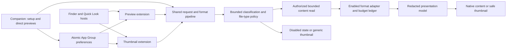

# SpacePane — implementation plan

Updated: 2026-10-10 (Europe/Istanbul). **Research is complete; the implementation now registers 76 logical file types with native safe presentations and expanded customization. Installed-host and release gates remain open.** The product name is SpacePane; Prev remains only as a technical working name. See [platform validation](docs/validation/platform-spike.md) for actual evidence and remaining gates. App Store publication preparation started on 2026-10-10; see the [publication plan](docs/plans/2026-10-10-app-store-publication-plan.md).

Build a native, local macOS 15+ app that supplies Finder previews and thumbnails for the requested QuickLook Pro feature set, adds themes and typography controls, and expands useful file-format coverage. Its companion app provides setup, settings, samples, and direct read-only previews as tabs in one app-owned window. App Store publication comes later. Maintain original branding, UI assets, and wording.

This is the implementation source of truth. [AGENTS.md](AGENTS.md) defines repository working rules; [CHANGELOGS.md](CHANGELOGS.md) records changes. Checked boxes mean completed deliverables, not intentions. Every implementation box remains open until its acceptance evidence exists.

## Completed research

- [x] Task 1: [macOS APIs and platform constraints](docs/initial/01-macos-apis.md).
- [x] Task 2: [all 116 supplied plugin/package entries and prioritized formats](docs/initial/02-format-ecosystem.md).
- [x] Task 3: [Apple HIG mapping and accessibility](docs/initial/03-apple-hig.md).
- [x] Task 4: [stack, dependencies, customization and performance strategy](docs/initial/04-technology-stack.md).
- [x] Task 5: [UI/UX flows, wireframes and failure states](docs/initial/05-ui-ux.md).
- [x] Task 6: read all five reports, reconcile decisions, and produce this plan and [decision synthesis](docs/initial/06-decision-synthesis.md).
- [x] Create repository guidance and change history; initialize local Git without a commit or remote.
- [x] Incorporate the user's modularity, separation of concerns, SRP, DRY, KISS, YAGNI, open/closed and dependency-inversion requirements into the architecture and [format extension contract](docs/decisions/001-format-extensibility.md).
- [x] Specify user-controlled file types, shared enablement policy, persistence and platform limits in [the file-type controls decision](docs/decisions/002-file-type-controls.md).
- [x] Record that the app name may change and separate replaceable branding from stable technical identity and saved preferences.
- [x] Record the requirement to replace hardcoded use-site strings with localized resources, typed code references and single-owner definitions.
- [x] Make multilingual support and internationalization of all app-authored visible text mandatory, including accessibility and both extensions.
- [x] Confirm that country-specific plans mean regional prices and record the App Store Connect/repository boundary.

Research coverage is not shipping support: 102 catalog entries have inspected substantive primary evidence, 13 have unavailable/incomplete evidence, and one has no supplied source. No third-party implementation is approved for bundling yet. Detailed source links and qualifications live in the reports.

### Added requirement: CAD exchange previews

See [the accepted CAD architecture](docs/decisions/006-opt-in-cad-previews.md), [dependency audit](docs/dependencies/occt.md), and [current validation](docs/validation/cad-previews-2026-10-04.md).

- [x] Identify the supplied local `.igs` sample as IGES and record structural evidence and primary-source research in [the feasibility report](docs/initial/07-cad-preview-feasibility.md).
- [x] Add IGES (`.igs`, `.iges`) and STEP (`.step`, `.stp`) as independent, **default-off** catalog types. Preserve opt-in behavior across schema 1–5 upgrades, Reset and future additions after Enable All. The catalog now contains 24 logical types.
- [x] Pin and audit the minimal OCCT development dependency; import bounded bytes in a disposable process with parent cancellation/deadline/kill/reap, CPU and sampled-memory guards, and retained notices. Release licensing remains a separate gate.
- [x] Add a neutral validated mesh capability, focused CAD module and native Metal renderer without vendor types or CAD-specific branches in host controllers; retain existing-format tests.
- [x] Implement trimmed surface tessellation, units/transforms, finite mesh validation, orbit/pan/zoom/fit/reset, standard views and localized controls. Reject failed/partial faces and external/multifile references explicitly.
- [x] Validate synthetic STEP/IGES geometry, units, transforms, trimmed holes, poles, malformed/oversize input, source integrity and cancellation; import all 720 faces of the private IGES example without committing or modifying it.
- [x] Build/sign the companion and both extensions, with inherited-sandbox CAD helpers in the companion and independently sandboxed preview XPC service only. Observe the supplied IGES model and working view/zoom controls in the signed companion's existing tab.
- [x] Keep CAD thumbnails generic and content-free; prove disabled requests never construct importers and ordinary text does not construct geometry/GPU resources.
- [x] Observe IGES and STEP geometry in signed Finder Quick Look, including the supplied 720-face model and close/reopen behavior with the companion stopped. Use bounded XPC service import and host-managed visibility for remote views; wider platform acceptance remains separate.
- [ ] Complete macOS 15/Intel execution, human physical-gesture/VoiceOver/keyboard/language review, broad CAD corpus and cold/warm host performance/memory validation. Sampled helper memory limits permit transient overshoot.
- [ ] Resolve the static dependency's corresponding-source/relinking obligations and final App Store distribution route before publication.

## Initial implementation progress

These completed pieces are narrower than the milestone exit criteria below. They do not close M0 or claim full baseline support. [Validation evidence and implemented limits](docs/validation/platform-spike.md).

- [x] Create five acyclic shared targets and concrete text/JSON adapters with explicit composition, typed outcomes and a retained serial worker per pipeline.
- [x] Implement and test bounded reading, encoding, JSON source validation, shared concealment, disabled-parser enforcement and cooperative cancellation.
- [x] Implement and test stable-ID preferences, first-run defaults, fail-closed recovery, schema migration and atomic publication with independent readers.
- [x] Add the three-target Xcode scaffold, centralized branding/identity configuration and deterministic project/manifest/resource validation.
- [x] Add typed development-language resources, generation/validation tools and package-bundle localization tests; multilingual release coverage remains open.
- [x] Run the integrated shared suite successfully: 33 tests including parameterized cases, through the project-local entrypoint.
- [x] Type-check the companion and both extensions with Swift 6 complete concurrency checking; build, ad hoc sign and launch a companion-only prototype with embedded package resources.
- [x] Verify native companion rendering of a synthetic sensitive JSON fixture, immediate disabled-content clearing and restoration after resetting file-type choices.
- [ ] Complete signed Xcode installation, App Group integration and real Finder lifecycle/routing validation; signed build and JSON Finder preview now work; the broader lifecycle/thumbnail matrix remains incomplete.

### Appearance implementation progress

This shared-renderer work proceeds locally while M0's signed-host gates remain open. [Appearance validation and GUI limitations](docs/validation/appearance-slice.md).

- [x] Add typed themes and bounded typography values with strict schema 3 persistence, schema 1/2 migration and independent appearance reset.
- [x] Add native Appearance settings, localized controls/status and an inert live sample using the same renderer as previews.
- [x] Apply JSON syntax colors only after redaction; cap styling work and preserve exact text, selection and viewport during style updates.
- [x] Verify the integrated 57-test suite, 93-key resource checks, all three host typechecks, and companion build/launch with visible redacted JSON coloring.
- [ ] Complete settings interaction, no-reread and reset/relaunch GUI checks; the UI inspection service crashed while inspecting Appearance.

### JSON Lines, controls and line-number progress

The [continuation validation report](docs/validation/json-lines-and-controls.md) records the exact local scope and open GUI/platform checks.

- [x] Add independent JSON Lines/NDJSON concealed source using the existing pipeline and presentation, with cumulative parser budgets, BOM provenance, fixtures and existing JSON regressions.
- [x] Add explicit imported/optional UTType metadata, localized type descriptions and most-specific conformance selection; validate static registrations against the shared catalog.
- [x] Implement optional displayed-logical-line gutter numbers outside text storage/copy/find; validate wrapping, Unicode, scrolling, selection, hidden width and narrow hosts.
- [x] Persist line-number choices in strict schema 4 snapshots, migrating schemas 1–3 without changing prior appearance or enablement choices.
- [x] Add catalog-derived native mixed group controls, explicit search-hidden scope and one complete snapshot per action, preserving global defaults and unrelated choices.
- [x] Add isolated checks against actual companion models for absent-source appearance retention, atomic group actions, corrupt-storage repair and failed-save retry.
- [x] Verify 90 package tests, four companion model checks, 101 resource keys, all three host typechecks and companion build/launch; observe JSON Lines in Supported Files.
- [ ] Complete Settings interaction and accessibility auditing: native inspection still crashes in SkyComputerUseService while the companion remains alive.
- [ ] Validate real Finder/thumbnail routing and App Group behavior on the supported OS matrix; imported declarations and compiler checks do not close those gates.

### Signed shared-settings configuration

- [x] Diagnose the reported Finder message against the registered signed artifact: its App Group remained a rejected compile-only placeholder.
- [x] Generate brand-independent local bundle/App Group identifiers with user authorization, reuse the configured signing team, and retain the values in ignored local configuration.
- [x] Build and verify signed app/preview/thumbnail bundles with matching App Group metadata and signed entitlements using full Xcode 27.0.
- [x] Observe the sandboxed companion saving shared settings, Finder's disabled-JSON state, and a successful JSON Space-bar preview after re-enabling it.
- [x] Separate build/container configuration failure guidance from saved-snapshot recovery guidance; validate 102 resource keys and the existing 90 package + 4 model checks.
- [ ] Complete the remaining installed-host matrix, including independent thumbnail invocation, companion-quit lifecycle, other formats/OS versions and full accessibility. See [configuration validation](docs/validation/shared-settings-configuration.md).

### Single-window navigation progress

- [x] Replace separate companion/settings scenes with one singleton window containing Setup, Try Preview, Supported Files, Settings, Customization and Help tabs; preserve modular feature views and shared session ownership.
- [x] Route Command-comma, settings buttons, About and Help to the main window; observe native navigation and retained JSON content after switching between Preview and Settings.
- [x] Verify the signed Xcode build, 90 package tests, four companion model checks and 105 localization keys. Record [navigation validation](docs/validation/single-window-tabs.md).
- [ ] Complete Customization interaction/accessibility auditing and macOS 15 runtime coverage; the native inspection service still fails when reading Customization.

### Installed-host continuation

- [x] Observe a newly created JSON fixture through Finder's preview pane and Space-bar panel with the companion process stopped, including concealment and unchanged source bytes. See [2026-10-04 host evidence](docs/validation/installed-host-2026-10-04.md).
- [x] Separate observed routing from parser support: this host resolved JSON Lines to a third-party UTType and showed a generic preview; plain text used another provider. Thumbnail generation did not establish invocation of this app's generic provider.
- [x] Attribute the repeat Customization inspection crash to SkyComputerUseService using its crash report and the still-running companion process; retain the live GUI audit as incomplete.
- [ ] Verify graceful quit/cold extension lifecycle and actual thumbnail invocation; run the remaining macOS 15/Intel and competing-provider matrix without provider overrides or cache resets.

### Direct file-drop progress

- [x] Implement a localized, adaptive drop strip in Try Preview with a narrow synchronous native file-URL adapter and the existing session/pipeline; preserve Open/Command-O and existing content on invalid drops.
- [x] Add three isolated private-pasteboard checks for one native URL, multi-item rejection, malformed/nonlocal input and metadata-only hover; verify 90 package tests plus four companion-model and three drop checks, 107 localization keys and a signed Xcode build.
- [x] Observe the drop instruction and Open alternative in the signed single-window UI; open JSON Lines using Command-O and confirm concealed source. See [drop validation](docs/validation/direct-file-drop.md).
- [ ] Verify a real Finder-to-sandbox drag, rejected/cancelled drag feedback, VoiceOver, translated layout and macOS 15 runtime. Helper tests and a visible drop target do not establish these interactions.

### Parallel text, baseline and customization expansion

The [2026-10-04 expansion report](docs/validation/parallel-expansion-2026-10-04.md)
records implemented restrictions, tests, installed observations and open gates.

- [x] Extend request input capabilities to binary bytes, bounded random access and directory metadata while preserving shared disabled-type, cancellation, privacy and mutation checks.
- [x] Register 22 logical types, exact filename/prefix identities and synchronized manifests/settings without regenerating the user's Xcode project.
- [x] Implement lexical source highlighting, native JSON/JSONL outline/records, configuration subsets, environment/package summaries, inert Markdown and diff/XML/plist/strings/OPML adapters with focused fixtures.
- [x] Implement bounded SQLite snapshot/schema/initial row-page inspection, ZIP/ZIP64/TAR/GZIP/XIP listings, immediate folder metadata and MIDI 0/1 parsing plus native playback controls. Limits and unsupported cases remain explicit in the report.
- [x] Add schema 5 semantic syntax styling, bounded named appearance profiles and inert JSON theme import/export; retain prior-schema migration, format choices and loaded safe content.
- [x] Record the user-selected 14-language set, typed summary labels and a strict dictionary/catalog/resource workflow. Translation resources are drafts; native-speaker and actual-host review remain open.
- [x] Verify the conservative SQLite reader against an independent process holding its write-lock range, with unchanged file bytes and no sidecar creation.
- [x] Observe native JSON outline and rendered Markdown with concealed synthetic secrets in the signed singleton companion.
- [x] Attribute a modern thumbnail-generator request to the current signed extension, then repeat with the companion stopped. The obsolete placeholder registration was resolved by rebuilding its existing development artifact.
- [x] Pass 162 package tests, four companion-model groups, three drop groups, independent SQLite locking/no-write validation, all three compiler checks and the signed 14-language Xcode build; verify bundle resources and entitlements.
- [x] Observe Portuguese and Spanish Setup launches and visible translated tabs at the default window size; use native grouped tabs to prevent toolbar overflow from hiding navigation.
- [ ] Complete real Finder drag grants, graceful/cold lifecycle, per-format routing/thumbnail surfaces, installed MIDI interaction, macOS 15/Intel and full keyboard/VoiceOver/customization audits.
- [ ] Complete native-speaker review, translated layout and independent effective-language validation in the companion and both Finder extensions before advertising shipping languages.

### Interaction and measurement continuation

See [interaction validation](docs/validation/interaction-continuation-2026-10-04.md)
for precise host observations and the remaining accessibility limitations.

- [x] Derive filename details from suffixes, exact aliases and prefixes in one companion model; preserve technical spellings and use locale-aware list formatting in both catalog screens.
- [x] Verify Settings navigation through Command-comma and exact-name filtering in the singleton window without changing file-type preferences.
- [x] Observe YAML source fallback, Markdown Source/Rendered modes and an expandable ZIP Summary in Finder after native companion quit, attributing the signed provider and verifying unchanged synthetic source bytes.
- [x] Fix and cover outline Copy responder ownership, style-preserved selection, fresh-generation reset, redundant accessibility descriptions and disabled cleared MIDI controls; retain concealed Markdown copy and inert links.
- [x] Add and run a repeatable Release core-pipeline benchmark on this Apple silicon host, with eight synthetic cases, distinct first-process/warm samples, process-memory scope and no-source-mutation checks. [Measurements and limits](docs/validation/release-pipeline-benchmark-2026-10-04.md); complete renderer/Finder and OS/hardware benchmarks remain open.
- [x] Harden localized positional-argument checking and atomic merge validation; verify 13 localization-tool tests plus 169 Swift tests, five companion-model and three drop groups, the SQLite check and signed build.
- [x] Observe translated German Setup/Settings at the default size, including exact filename patterns; keep minimum-width resizing and human language review open.
- [ ] Complete the remaining keyboard/VoiceOver and Customization UI audit; native inspection again failed inside the automation service while the app stayed alive.

### Four-workstream quality pass — 2026-10-04

- [x] Generate and independently parse a complete 22-format synthetic fixture set, record resolved UTTypes, and observe every fixture through Finder's Space-bar panel with the companion stopped. Eighteen reached our presentation; `.txt`/`.swift` used another provider and `.env`/JSON Lines were generic. [Host matrix](docs/validation/finder-matrix-2026-10-04.md).
- [x] Repair XML CDATA/processing-instruction concealment and TAR/XIP entry cancellation, add direct adapter/deadline/mutation/budget regressions and a deterministic 176-case corpus across all 22 types. [Security and performance](docs/validation/security-performance-2026-10-04.md).
- [x] Own theme-import cancellation and replacement, reject duplicate profile names in the model, retain previews when Open is cancelled, and expose typography values to accessibility. Add five isolated interaction groups and tab shortcuts using existing localized route references. [UI evidence](docs/validation/ui-quality-2026-10-04.md).
- [x] Verify Command-1/2/3/4/6 navigation in the existing singleton, retained concealed JSON across tabs and an actual cancelled Open sheet. Customization remains separately unverified.
- [x] Verify 33 explicit language-selection cases against all 259 runtime keys in each of the three signed bundles, including regional aliases, development fallback, bundle/type metadata and unchanged resources. This is artifact lookup evidence, not effective Finder language.
- [x] Correct four technical German/Indonesian/Hindi translation values, add translator context and five localization regressions. Keep all 14 languages draft pending contextual speaker/UI review. [Language evidence](docs/validation/language-quality-2026-10-04.md).
- [x] Pass the integrated 184-test Swift suite, five companion-model groups, five appearance-interaction groups, three drop groups, cross-process SQLite checks and 176-case corpus; validate 259 keys/14 languages and 13 localization-tool tests.
- [x] Measure Release native rendering with separate cold/warm samples and process-memory scope. Native timings expose work omitted by the earlier core benchmark; performance targets remain unfulfilled where measured values exceed them.
- [x] Replace the false MIDI filesystem preflight with optional public audio-unit metadata; pass 13 targeted MIDI checks including a real silent device smoke, rebuild the registered artifact, and observe Finder Play/Pause/scrub/resume/end with the companion stopped. Verify the new XML concealment fix in the same rebuilt host.
- [ ] Verify audible MIDI note output/timbres, format 1 and other audio-device/OS combinations; the successful silent transport fixture does not establish these.
- [ ] Complete live Customization/theme-sheet/VoiceOver/large-text review, real sandboxed Finder drag, every-language host behavior and native-speaker sign-off.
- [ ] Complete per-format thumbnail surfaces, macOS 15 and Intel runtime coverage, cold extension lifecycle and competing-provider matrix; repeat on the exact final installed artifact.
- [x] Optimize native outline identity/updates/cell reuse and per-pass styling; defer hidden Source work, preserve exact Unicode replacements and remeasure the unchanged 420-sequence Release benchmark. [Results and limits](docs/validation/native-renderer-performance-2026-10-04.md).
- [x] Pass 196 Swift tests plus the isolated integration checks, both signed development builds and 33 three-bundle language probes; observe Source/Records in the singleton companion and Source/Outline in the rebuilt Finder provider with unchanged synthetic sources.
- [ ] Profile and optimize the remaining initial Source costs. Whole local pipeline + construction + initial-draw warm p95 still exceeds 200 ms for text (216), JSON (434), JSON Lines (365) and source code (250); isolated drawing improvements do not close the useful-content gate.
- [ ] Measure incremental preview memory and Finder first-visible-content timing before making memory/host-latency target claims; current RSS includes AppKit and multiple rendering stages.

### Companion sidebar redesign — 2026-10-04

- [x] Replace the six grouped tabs with a fixed sidebar (General, File Types, Theme, About) in the same singleton window; route Command-comma to File Types and About/Help to About. Record [the decision](docs/decisions/010-companion-sidebar-redesign.md).
- [x] Add Developer Mode, off by default and stored only in the companion's defaults; it alone reveals Try Preview, Open File, Command-O and Command-5, and turning it off closes the preview session.
- [x] Rebuild General, File Types, Theme, About and Try Preview from shared page, card, row, status and two-column components; keep every earlier appearance control, the file-type semantics of decision 002 and the direct-drop contract.
- [x] Report only what the app can know: settings storage state and enabled-type count. Leave out prototype controls with no truthful backing and list each in the decision record.
- [x] Add 59 localized keys and retire 9 in all 14 languages (356 keys); pass `--check`, 453 package tests, 10 companion model checks, the signed build and 33 three-bundle language probes. See [validation](docs/validation/companion-redesign-2026-10-04.md).
- [x] Inspect the real signed window: title-bar clearance, selection appearance, every page, and immediate sidebar and menu changes when Developer Mode is toggled.
- [x] Rename the product to SpacePane through branding configuration only and set its website to spacepane.com; keep bundle and App Group identifiers, targets and stored settings unchanged.
- [x] Let the Theme page's live preview show a built-in sample of any catalog format through the production pipeline; enforce one sample per format in `--check` and cover every text-presentation sample with a model check. See [the appearance decision](docs/decisions/003-preview-appearance.md).
- [ ] Choose each sample type in the real window, including the two CAD samples under the sandbox, and decide whether per-format appearance overrides are wanted (a separate schema change).
- [ ] Verify live resizing across the column breakpoints, the Open System Settings link and the Website row in the real window.
- [ ] Complete VoiceOver, Full Keyboard Access, large-text and increased-contrast checks for the new pages, and translated layout in the eleven languages not rendered.
- [ ] Decide separately whether to add a shared master switch, a default view mode and configurable limits (schema 6), the documentation and feedback About links, and whether technical identifiers should ever follow the new name (a separate migration review). The app icon and the support and privacy links were added for release; see M6.

### Files without an extension — 2026-10-04

- [x] Add the `text.extensionless` format with its own switch, declared as `public.data` by the preview extension only; classify root types exactly and never by conformance. Record [the decision](docs/decisions/011-extensionless-files.md).
- [x] Show only text (UTF-8, or UTF-16 with a mark), report anything else as binary content, style interpreter scripts as source, and route well-known shell and build file names to Source Code.
- [x] Pass `--check`, 464 package tests and the all-format fixture check; observe `zprofile`, plain text, binary and a JSON control in Finder. See [validation](docs/validation/extensionless-files-2026-10-04.md).
- [ ] Observe dotfiles, other volumes and a competing `public.data` provider in Finder; decide whether to cover executable-bit files (`public.unix-executable`).
- [ ] Before distribution, confirm the `public.data` declaration is acceptable for App Store review, and remove stale development copies of the extension from test machines.

### Competitor parity program — 2026-10-05

See [the program decision](docs/decisions/025-competitor-parity-program.md), its workstream decisions 013–024, and [the integration validation](docs/validation/parity-program-2026-10-05.md).

- [x] Agree shared contracts and per-family registration points before parallel work: image and source-language contracts, request options and name hints, mode views, summary label sets, a shared ZIP reader, catalog-derived manifests and a batch localization tool.
- [x] Add 45 formats across archives, markup documents, diagrams, packages and certificates, columnar, scientific and geographic data, code and captions, ebooks and comics, and meshes (76 catalog types, 309 suffixes), each with its own switch, sample, fixture, tests and localized names.
- [x] Add the Contents, References, Diagram, Pages, Icon, Files, Tree, Plot and Rows modes, live reload, Go to Line, Copy All, outline filtering and row copy, temporary zoom and the provider badge.
- [x] Draw concealed content thumbnails for 41 formats behind a user switch; keep sensitive formats generic and the system's mesh thumbnails in place.
- [x] Persist preferences schema 6 (behavior switches and eleven contrast-checked color schemes) and add Quick Look provider diagnostics in the companion.
- [x] Integrate all twelve branches and the cross-family follow-ups; pass `--check`, `--check-compiler` and `--test` (2,086 Swift tests, every integration check, 648 adversarial cases) and build the thumbnail extension with Xcode.
- [ ] Observe the new formats, modes, content thumbnails and live reload in signed Finder hosts; record per-type provider routing, especially for types macOS or other apps also preview.
- [ ] Build and run the signed app and preview extension with the new package products; verify Security CMS and code-signing calls, the provider scan and file monitoring inside the App Sandbox.
- [ ] Review the new strings with native speakers, check translated layout and VoiceOver for every new mode, and measure Release performance of the new adapters and views.
- [ ] Decide the carried-forward gaps: notebook figures above about 24 KiB, whole-file formats over 1 MiB (HAR, geographic data, torrents), only the first Mermaid fence becoming a diagram, assumed millimetres for STL/OBJ/PLY, and table position across live reloads.

### Safety Lens and insight features

Started 2026-10-05 at the user's request, following [the unique-feature research](docs/market/2026-10-05-unique-feature-opportunities.md). [Decision 012](docs/decisions/012-safety-findings.md) records the contract and the per-feature rules; [the validation record](docs/validation/safety-lens-2026-10-05.md) records evidence and limits.

- [x] Add typed findings (kind, severity, count, displayed lines, typed detail) to the adapter, privacy and presentation contracts with empty defaults. Add one shared definition of a logical line, a findings banner in the shared renderer with Copy Concealed Text, and 107 localized strings.
- [x] **Notebook health:** out-of-order execution, gaps in execution numbers, cells that never ran, saved errors and a reproducibility hint. Built from the validated notebook tree; nothing runs.
- [x] **Archive risk report** for ZIP/ZIP64, TAR, GZIP-wrapped TAR and XIP:
  - unsafe paths, links leaving the archive, apps and scripts, disguised and direction-changing names;
  - encrypted and nested entries, extreme compression and large totals;
  - hidden entries, case collisions and `__MACOSX`.

  Risky entries are now listed instead of failing the archive.
- [x] **Secret inventory** by kind and displayed line, a sync-folder warning for iCloud Drive and `~/Library/CloudStorage` providers (a path test with no file access), and Copy Concealed Text.
- [x] **Hidden-content detector:**
  - bidirectional controls, zero-width characters, Unicode Tags (decoded and concealed), stray variation selectors and private-use characters;
  - mixed-script look-alike words and hidden Markdown comments;
  - AI-agent instruction-file escalation;
  - an Invisibles mode with technical markers.

  Concealment now also covers keys disguised with invisible characters.
- [x] **CSV/TSV Profile mode:** types, missing values, distinct counts, exact extremes, mean, common values, distribution and quality notes. Concealed columns report only their empty count.
- [x] **CAD measurements:** surface area, volume for closed surfaces, bodies, and the STEP schema or IGES version with the originating system. Author, organization and file names are never read.
- [x] Pass the package suite, host typechecks, `--check` and the `--test` gates, including real-worker CAD end-to-end measurements. See the validation record.
- [ ] Observe the banner, the Invisibles and Profile modes and the CAD lines in the signed companion and in Finder's Space-bar panel and preview pane with the companion stopped. Confirm Copy Concealed Text works from the Quick Look extension.
- [ ] Complete VoiceOver, Full Keyboard Access, large-text and increased-contrast review of the banner, markers and profile table, and translated layout in all 14 languages.
- [ ] Native-speaker review of the 107 new draft strings. Kurmanji and Hausa have the lowest confidence.
- [ ] Measure the renderer and Finder first-content timing with findings and the Profile mode, on Release builds, macOS 15 and Intel.
- [ ] Decide on sewing IGES shapes in the native worker so cracked tessellations can report volume. This needs its own native-code and dependency review.
- [ ] Decide whether to cover:
  - binary property lists in the hidden-content scan;
  - iCloud "Desktop & Documents" and other File Provider locations in the sync warning;
  - a JSON Lines profile;
  - more AI-agent file names.
- [ ] Before marketing, recheck uniqueness claims, and word them as "no other Quick Look app we found".

### World-class UX/UI program — 2026-10-06

Started at the user's request: feature parity is largely done, so the same capabilities must now be presented better than any competitor's. The evidence is [the competitor UX/UI analysis](docs/market/2026-10-06-competitor-ux-ui-analysis.md) with seven cluster reports under [docs/market/ux-research/](docs/market/ux-research/); the program, its two anatomy contracts, workstreams and acceptance gates are [decision 026](docs/decisions/026-world-class-ux-program.md). Competitor observations are marketing material, not tests.

- [x] Research the UX and UI of 40 competitor and reference apps against one eight-dimension rubric, from every App Store and vendor screenshot; audit SpacePane's own preview states and companion pages from code (32 findings, top-20 fixes); record Apple's Quick Look baseline, HIG rules and macOS 26 constraints.
- [x] Synthesize: no competitor presents its formats through one anatomy, shows its limits, states privacy in the interface, or labels its shortcuts; SpacePane leads on substance and trails the leader on presentation in all eight dimensions. Record the twelve principles, the preview and companion anatomy contracts, the rejected patterns and the open owner decisions.
- [x] Correct the landscape: Unfold's changelog lists STEP previews in 3.2.0, so STEP is no longer a SpacePane-only differentiator among general apps; IGES still is, among the apps found.
- [x] Original owner questions answered or explicitly deferred in the [owner questionnaire](docs/reviews/2026-10-06-quality-review/owner-questions.md), under the owner's delegation on 2026-10-06. Apply decision 027's amendments; do not reopen these questions merely because this original checklist predates their answers.
- [ ] Lead: add the shared contracts (`PreviewChrome`, `muted`/`hairline` palette tiers with the contrast test, `NativeStateView`, `PresentationFacts`, strip slots, shared strings, markers) and the worktree per workstream.
- [ ] ux-chrome: facts strip, limits strip, one privacy row with a height cap, info popover with the shortcut sheet, Copied chip, gutter hairline, compact density, accessibility order.
- [ ] ux-modes-structure: default-first mode ordering and labels, keyboard mode switching, typed outline rows with counts and a path bar, quiet grid with a range footer, row-action and filter parity, JSONL separators.
- [ ] ux-documents: capped measure, Contents rail when wide, blocked-resource notice only when blocked, copy on code blocks, blockquote bar; prose face if approved.
- [ ] ux-containers-3d: folder and archive summary header and hidden counts, encrypted states, native 3D control cluster, dimensions in the facts strip with declared units (decision 027's amendment), one-time camera hint.
- [ ] ux-companion: page hierarchy and sidebar material, neutral single-home status, numbered setup trail with the conflict scan beside it, renderer pills and native search with conflict markers in File Types, pinned Theme sample with a scheme gallery, Undo for bulk actions, Try Preview inspector, menu labels.
- [ ] ux-copy: title/body failure strings with next steps and limit values, header-length and apostrophe sweep, Summary jargon, 14-language drafts.
- [ ] ux-thumbnails: type badge and shape-with-counts rendering within the content switch and privacy rule.
- [ ] Validate the twelve acceptance gates of decision 026 in the signed companion and in Finder's Space-bar panel and preview pane on macOS 15 and 26, with VoiceOver, 200 % text, three long languages and the Release renderer benchmark; measure real pane widths before fixing the compact threshold.

### Best-in-class quality program — 2026-10-06

Ten parallel reviewers covered the whole product, not only presentation: preview chrome and states, structured views and modes, documents, media and 3D, the companion, performance, security and privacy, accessibility and localization, architecture and verification, platform integration and release, and thumbnails. The reports and their synthesis are under [docs/reviews/2026-10-06-quality-review/](docs/reviews/2026-10-06-quality-review/README.md); the prioritized program is [decision 027](docs/decisions/027-best-in-class-quality-program.md), which amends decision 026 and sequences its workstreams with the quality work into five waves. The original review ran on Linux from source only; subsequent implementation and hosted verification are recorded below. Implementation-wave boxes remain open until their deliverables and Mac evidence exist.

The [2026-10-07 continuation plan](docs/plans/2026-10-07-quality-program-continuation.md) reconciles all 133 backlog items against committed source and orders the remaining work. The [synchronization record](docs/validation/quality-program-sync-2026-10-07.md) preserves the starting evidence; the [implementation record](docs/validation/quality-program-implementation-2026-10-07.md) records recovery of all three missing Round 3 integration files, the deterministic cancellation check, and the full local and hosted green S0 baseline at `a063847`. Rounds are authoring batches, not completed waves.

- [x] Review ten dimensions from source against one brief and one template; verify the self-audit and decision 026 against the code; record scores, blockers, cross-dimension findings, corrections and 27 owner decisions; write the plan with its two-environment protocol, blind-authoring rules, the pending-verification queue, the continuous-integration proposal, the amendments to decision 026, the waves, the backlog (Q-01 to Q-181) and the gates G13–G20.
- [x] Owner decisions of group A (D5, D6, D8, D13–D19, D25) answered or deferred, so Wave 0 can start. (All 29 answered on 2026-10-06 in `docs/reviews/2026-10-06-quality-review/owner-questions.md`.)
- [ ] Wave 0: the six Blockers and the honesty Majors fixed in source with tests (Q-01 to Q-12); the portable static gate, the syntax gate, the ownership check, the continuous-integration workflow, the plural tooling, the benchmark tooling and the documentation hygiene committed (Q-18 to Q-27); decision 026 amended; every cloud commit in the queue.
  - Status 2026-10-07: the initial fixes and verification floor passed hosted run 19; Q-11 and Q-27 landed in Round 2, whose full hosted run 33 passed. Q-25's status matrix and localization documentation landed with the recorded exception retaining historical validation filenames and open progress sections. Q-24 now has typed pipeline intervals, a portable paired-run comparator, actual physical-footprint probes, all planned bounded fixture families and source/build fingerprint validation. Actual native renderer intervals are integrated. A clean branch baseline at `acec21b` completed 16 pipeline and 14 native scenarios with ten cold/fifty warm samples each; [the report and raw artifacts](docs/validation/quality-program-release-baseline-2026-10-07.md) preserve fingerprints and physical footprint. Required interleaved A/B comparisons, the final/main baseline and actual hosted paint measurements remain. Source presence and hosted tests do not close the outstanding runtime observations.
- [ ] Wave 1: one Mac session records the host matrix on the production identity, the measured pane widths and safe area, the remote-view spike (tooltips, popovers, key delivery), the completion-handler experiment, the macOS 15 symbol check, the thumbnail and source-type tables, the sandbox scan, the System Settings link, a VoiceOver baseline and the re-baselined benchmarks, and closes the queue's first rows.
  - Status 2026-10-08: the signed `603e0d0` artifact built and launched with the production identity; 33 bundle-language/fallback checks pass. Fresh JSON Lines and notebook previews are attributable in the Finder pane and Space-bar panel after removing a duplicate app registration. [The signed-host record](docs/validation/quality-program-signed-host-2026-10-08.md) retains hashes, OS/toolchain and keyboard-focus limits. These four cells do not close the broader matrix, thumbnail, VoiceOver, completion or minimum-OS gates. Signed `3a97e4f` later passes all 33 bundle-language cases at 1,082 keys and adds JSON pane/panel information/facts observations plus a revalidated JSON Lines pane; the signed-host record keeps each cell attributable. Full hosted run 37818484024 passes at that source.
- [ ] Wave 2: the lead's contract commit and the enabling refactors (Q-30 to Q-46) compiled and tested on a Mac with the test seams migrated and `NativePreviewView` decomposed, so that the workstreams can branch on disjoint files.
  - Status 2026-10-07: the contracts (`TextOrigin`, `PresentationFacts`, `GeometryUnitProvenance`, the two failure cases), seams, `PreviewChrome`, `NativeStateView`, typed notices, palette tiers, announcer, command table, failure copy, worker executor, linear concealment, thumbnail admission/reply gate, CAD peer requirement and privacy manifests passed hosted run 33. Catalog `primaryView` and its sample drift test also landed; run 40 passed the drift test after the catalog corrections. The state presenter, mode policy, TextKit content and header components have all been extracted in separately compiled/tested steps; all renderer suites pass in the 1,308-test integration tranche. `PreviewResult` and all production callers now carry the selected effective budget. Shared once-only reply scheduling, a cancellable 30-second preview-host session, typed host diagnostics and confirmed-empty source handling pass focused tests and all native source compiler checks. Actual host completion/density policy and measurements remain open. The facts contract alone does not implement the facts strip, and the density threshold is still an unmeasured placeholder.
- [ ] Wave 3: the twelve workstreams' deliverables (groups C-chrome to C-website) merged through the queue and the integration gate, or deferred with a reason recorded in decision 027.
  - Status 2026-10-07: Round 3 is partially integrated through `f391354`: pinned Theme sample, scheme gallery and settings error actions; RTL gutter and swatch access; CAD worker unit protocol, historical host matrix, source-offer tooling and website hydration/data changes. Other named Round 3 assignments are not evidence of committed output. Hosted run 40 compiled the package and type-checked the app/extensions, then ran 2,946 tests with one cancellation-timing failure; its integration stage did not run. The three absent companion checks have since been recovered, and the cancellation check now asserts delivery while the reader is deliberately held. S0 `a063847` passed the complete local entrypoint and hosted macOS run 37648392943, including every integration executable. Later batches have their own focused/compiler evidence in the implementation record; a full integrated run is required again. No signed-host acceptance is inferred from these runs.
  - Status 2026-10-08: Q15 now has a bounded notebook byte path with inert image placeholders and saved figures; Q150 adds converted-text and listing-name classification; Q155 applies detected Tag-copy hygiene to text and listing findings. Combined local verification at `5cfb8c1` passes 3,200 parallel tests, six isolated timing tests and all native integration executables; full hosted static/macOS run 37755632752 passes the follow-up canonical-ownership checkpoint `7e062b9`. The signed/observed artifact remains `603e0d0`. Q50 collapsed findings, Q154 image admission/footprint and Q151 surface canaries follow as test-first batches. No wave is closed by these package and compiler checks.
  - Status 2026-10-08: Q51 now consolidates table/listing limits in one bottom strip, with actual batch counts, conservative exact totals and lazy Profile counts. Focused native regressions pass; current integration and signed-host layout remain open. Q154’s [Release image-footprint measurement](docs/validation/quality-program-image-footprint-2026-10-08.md) demonstrates that the 100 MiB target is unmet despite source/admission caps; measured optimization is ongoing.
  - Status 2026-10-08: the integrated `070c91b` checkpoint passes 3,272 parallel tests, six serial timing tests, all native integration executables, 22 static steps, 148 contrast ratios and 648 adversarial cases. Q155 now includes native Rows/References copy services. Q151’s representative fixtures cover all 18 mode identities and caught/repaired an omitted-image privacy-range defect in ordinary notebooks. All-family and signed-host acceptance remains open; see the implementation record for exact scope.
  - Status 2026-10-08: Q52 now supplies cached family facts in the native single-row header, including read-boundary non-text sizes, total notebook cells, scalar density limits, declared geometry units and conservative partial/carried-image counts. Full Mac integration, source compilation and all 22 portable checks pass at `a73ac03` as detailed in the implementation record. Q53 now adds a native information disclosure, bounded inline provenance and help based on current command capabilities. Clean `bfcb7c1` passes 3,342 parallel tests, six isolated timing tests, every native integration executable, source compilation and all 22 portable checks with no skips. Compact native mode/gutter integration now passes 3,355 parallel tests, six isolated timing tests and every native integration executable at `3862820`; the unchanged production sources pass host-source compilation. Signed-host density/VoiceOver, measured thresholds and reviewed translations remain open. The October 8 requested stop ended with the user’s October 9 continuation. Full hosted run 37899995290 passes `e798e9c`. Q153’s policy wrapper passes 14 Debug/Release tests; complete/leading reader integration passes 27 focused/native controls, with other file-access boundaries and provider proof still open. Q72 native quote/emphasis styling passes 98 related tests. Q154’s optional scheduler observation passes 35 tests, but cache/draw measurements remain rejected pending lifecycle geometry validation.
  - Status 2026-10-09: clean `3e6e1b2` passes 3,393 parallel tests, six isolated timing tests, every native integration executable, all four host-source compiler groups and 22 static checks with zero skips. Q72 quote/emphasis, Q153 complete/leading read refusal and Q154 causal measurement seams are integrated locally; remaining program and signed-host/release gates stay open.
- [ ] Wave 4: decision 026's twelve amended gates and gates G13–G20 recorded in the signed companion and in Finder on macOS 15 and the current release, with a TestFlight round for the store-signed build; screenshots, store text, manifests, the OCCT route and the deployed pages follow.

## Product contract

| Requirement | Planned behavior | Milestone |
|---|---|---|
| Finder preview and thumbnails | Modern separate app extensions; companion can quit; explicit content-type manifest | M0–M1 |
| Code and text | Selectable highlighted text, line numbers, find, wrapping; UTF-8/UTF-16; dotfiles and extensionless text when routed | M2 |
| Structured configuration | JSON tree/source, JSONL records, common YAML/TOML tree or safe source fallback; package.json summary | M2 |
| Privacy | Likely secrets hidden by default; redaction across all representations; no account, uploads or subscription requirement | M1–M3 |
| Markdown | Rendered GFM subset and source view, safe links, no document code execution | M2 |
| Customization | Light/dark/high-contrast themes, family/size/weight/italic, spacing, ligatures, tabs, token styles and live sample | M2 |
| File-type controls | Searchable individual/group/all-type switches; stable saved choices shared by preview, thumbnail and companion; no provider-handoff promise | M1–M2 |
| Multiple languages | Fully internationalized app-authored UI in all three bundles; reviewed translations for the chosen shipping languages, locale formatting and RTL validation | M1–M5 |
| Database inspection | SQLite tables, schema, indexes and bounded rows; no source or sidecar mutations | M3 |
| Containers | Folder summaries, ZIP/ZIP64/XIP listings, GZIP text/TAR handling, TAR listings, explicit limits | M3 |
| MIDI | Standard MIDI File 0/1, play/pause and scrubber using a validated macOS sound-bank path, no autoplay | M3 |
| Missing format coverage | Diff/XML/plist/localization first; notebooks, subtitles, snippets, NFO, CSV/TSV next | M2/M4 |
| CAD exchange files | Implemented opt-in IGES/STEP native 3D previews, rotate/pan/zoom/fit, localized controls and independent default-off toggles; platform/release gates remain open | M4 CAD workstream |
| Unavailable file content | Accurate metadata/error state if invoked; no reconstruction of missing bytes | M1 and every renderer |
| Safety and insight | A typed findings banner covering hidden Unicode, the secret inventory and sync-folder warning, archive risks and notebook health. Adds an Invisibles mode, Copy Concealed Text, a CSV/TSV Profile mode and CAD measurements | Safety Lens, [decision 012](docs/decisions/012-safety-findings.md) |
| App Store release | Sandbox, public APIs, bundled audited dependencies, verified product claims, later submission | M6 |

“Missing-file previews” includes both unsupported formats and unavailable contents. macOS selects the Quick Look provider; no implementation can promise invocation for every unknown suffix, directory, extensionless file or deleted item. The companion's explicit Open/Drop workflow uses our own pipeline and remains useful when Finder selects another provider. It must not merely embed a system Quick Look consumer and assume that chooses Prev.

The quoted comparison app is the baseline target, not a claim that its implementation has been inspected. Split ZIP archives, sparse TAR entries, ZIP central-directory encryption and MIDI format 2 start as explicitly unsupported. Encrypted ZIP members are listed and flagged, but their contents are not inspected. Advanced YAML/TOML can fall back to highlighted source. XIP listing does not verify signatures. These are visible limits, not silent partial success.

## Accepted architecture

**Swift + SwiftUI + targeted AppKit, Xcode app/extension targets, local SwiftPM libraries.** SwiftUI owns companion scenes and settings. An AppKit `NSViewController` conforming to `QLPreviewingController` owns interactive preview content; native text/table/outline adapters are used where needed. A separate `QLThumbnailProvider` uses stricter budgets and safe representations. [API report](docs/initial/01-macos-apis.md), [stack comparison](docs/initial/04-technology-stack.md).

Target data flow: thumbnails for `content` formats run the shared pipeline under a strict thumbnail budget and draw only its concealed output or validated document images ([decision 022](docs/decisions/022-content-thumbnails.md)); other formats keep the content-free glyph. Thumbnails never invoke interactive or audio renderers.



Repository structure — the app, extension and package targets now exist. Some reserved folders, fixtures and integration suites below remain planned:

```text
Prev.xcodeproj
Apps/PrevApp/{App,Views,Models,Stores,Services,Support}/
Extensions/PrevPreviewExtension/
Extensions/PrevThumbnailExtension/
Packages/PreviewCore/
  Sources/{PreviewContracts,PreviewCore,PreviewFormats,PreviewPreferences,PreviewRenderers}/
  Tests/
Fixtures/{Normal,Malformed,Large,Sensitive,Synthetic}/
Tests/Integration/
script/build_and_run.sh
.codex/environments/environment.toml
docs/{initial,validation,decisions}/
```

Keep the parsing target independent of UI and companion-only APIs. `PreviewRenderers` may depend on AppKit/SwiftUI; thumbnails must not initialize interactive or audio views. All shared extension code enables extension-safe API checking. One package can contain these targets; split further only for a demonstrated boundary.

### Extending file support is a first-class architectural requirement

Modularity and separation of concerns take priority. The implementation follows SRP, DRY, KISS, YAGNI, open/closed and dependency inversion through concrete boundaries, not an elaborate plugin framework. [Detailed decision and format-addition workflow](docs/decisions/001-format-extensibility.md).

| Boundary | Responsibility | Dependency rule |
|---|---|---|
| `PreviewContracts` | Format IDs/descriptors, request/result models, small adapter/reader/presentation contracts | No AppKit/SwiftUI or vendor decoder types |
| `PreviewCore` | Request orchestration, authorized bounded access, budgets, cancellation, redaction and failure handling | Depends on contracts; never imports concrete format modules or UI renderers |
| `PreviewFormats` | Focused detection/parser adapters, organized by actual format family; third-party decoder wrappers | Depends on contracts and justified shared utilities; no host/UI imports |
| `PreviewRenderers` | Shared text, outline, table, document and other accepted presentation capabilities | Consumes safe presentation contracts; does not select or invoke concrete file parsers |
| `PreviewPreferences` | Validated settings, theme models and storage/migrations | No dependency on concrete format parsers; format-specific preferences use stable IDs |
| App/extension composition | Explicitly assemble adapters, service implementations and renderer capabilities | The place allowed to know concrete implementations; host callbacks otherwise remain thin |

Begin with format-family folders in `PreviewFormats`; introduce separate SwiftPM targets for heavy dependencies when those formats are implemented. Do not create a package per suffix. Share a parser across related formats only when their semantics genuinely match. Reuse presentations across different formats: JSON/plist can share an outline; CSV/SQLite can share table UI while retaining different readers.

One declarative catalog owns type metadata and capability IDs. The runtime registry binds those IDs to explicit adapter factories at composition time. Generate or validate supported-type manifests, help and file-type settings rows from that catalog. Avoid parallel extension lists and scattered filename switches in host views. Keep decoder initialization lazy; compiling in an adapter must not mean constructing every parser for every preview.

The normal new-format change is **adapter + catalog/registration entry + fixtures**, with dependency/notices or format-specific preferences only if needed. Existing pipeline, host controllers and unrelated adapters should remain unchanged. Introducing a genuinely new presentation kind may extend a shared contract deliberately; open/closed does not prohibit necessary architectural evolution.

Each adapter receives narrow authorized reading and request-budget capabilities. It does not open arbitrary paths, control global settings, bypass privacy policy, or manage host windows. Parsing returns immutable models and explicit limits/errors. The pipeline applies shared privacy policy before any renderer, clipboard, search or accessibility output consumes them. Optional paging or playback is expressed through focused capabilities when implemented, not mandatory methods on every adapter.

**Extensibility acceptance:** add a second real format using an existing presentation without editing orchestration or host logic; run shared adapter contract tests and regress the original format. Record the changed files and any necessary exceptions. Static bundled registration preserves this architecture; downloadable code plugins and an external plugin SDK are out of scope.

Choose Swift 6 language mode with complete concurrency checks. Record default isolation and upcoming-feature settings explicitly; inspect them before changes. UI state is `@MainActor`; parsing and blocking I/O use explicit bounded off-main execution. Do not mistake `async` for background execution or a task timeout for preemption of C code.

Each request owns an ID, an authorized read lifetime, immutable preference snapshot, cancellation/deadline state, resource ledger and parser/media resources. State is `loading → ready | partial | unavailable | failed | cancelled → disposed`. Obsolete work cannot publish to a replacement request. Every adapter returns typed bounded results and omissions; presentation never silently converts an incomplete document into a complete one.

**Settings decision:** one companion writer atomically replaces a small versioned preferences document in the App Group. Store rich theme/profile data in that schema or referenced validated data files; use group defaults only for simple independent flags. Do not duplicate the same preference across competing sources of truth. Extension requests read a coherent snapshot. Temporary preview overrides remain request-local. Precedence is temporary override → format-family override → global preference → built-in default. Existing previews and OS-cached thumbnails are not promised immediate refresh.

**Dependency decision:** prototype swift-markdown, SwiftTreeSitter with a small grammar set, Yams, TOMLKit, ZIPFoundation and a narrow TAR/GZIP/archive backend. These are candidates, not selected revisions. Prefer system SQLite and Apple media/image/certificate APIs where validated. No legacy generators, external interpreter prerequisites, downloaded executable plugins, or private CoreUI reuse. Native Markdown is the first renderer; WKWebView requires a recorded benchmark/accessibility justification and a complete resource/security policy before adoption.

### User-controlled file types

**The File Types page** offers search, individual switches, collapsible group controls with mixed state and an enabled count, Enable All Types, Disable All Types and Reset File Type Choices. Show suffix aliases explicitly; logical formats are independent of shared decoders. The same table replaces the earlier Supported Files list, so descriptions and effective choices have one home. Only shipped capabilities are switchable. [Full policy and acceptance contract](docs/decisions/002-file-type-controls.md).

Persist a global enablement default plus sparse stable-format-ID overrides in the existing preferences snapshot. Disable All changes that default to false and clears overrides, so newly added formats stay off too. Group controls update individual choices without another layer of stored group flags. Preserve choices across updates. Format enablement is a gate, separate from display-setting precedence; a temporary source mode or theme override cannot re-enable a type.

Resolve format identity with bounded probes before applying the policy, then skip content parser construction and decoding for disabled types. Do not let a disabled recognized format fall through to generic text. Preview and companion show a minimal disabled state; thumbnails use a generic glyph. Changes apply to new extension requests; in-app content updates and cancels when disabled. Existing Finder content and cached thumbnails may remain. Static type registration stays unchanged, and disabling Prev's handling does not guarantee macOS selects another provider.

### Replaceable app branding

**The product name is SpacePane, chosen 2026-10-04; its website is spacepane.com.** Prev was the working name. App/project paths shown here and names in research wireframes keep that working name as technical names or history, not as branding. Keep app and extension display names in a small shared build configuration, expose the display name to UI through a branding resource, and use localized templates for copy that mentions it. Keep icons and other brand assets easy to replace; do not build a runtime branding framework.

Reusable module names, format IDs, preference keys, schema versions and storage filenames must not derive from the visible name. Choose technical bundle/App Group identifiers deliberately at M0, then preserve them across a display-name change unless a separately reviewed migration requires otherwise. A marketing rename must not reset file-type choices or themes. Update current UI/help/store copy when the name is chosen; historical research and changelog entries can retain their original wording.

### Typed references and localized resources

Follow [the repository string/reference rules](AGENTS.md#strings-resources-and-code-references). User-facing text belongs in String Catalogs accessed through typed resources, with localized interpolation/pluralization and correct resource-bundle ownership. Domain code exposes typed IDs, modes and errors rather than presentation strings. Use generated asset references and existing framework symbols where available; isolate unavoidable string-only API values at their owning boundary.

The format catalog, typed preferences and build/branding configuration remain the single sources for their respective values. Do not duplicate suffixes, storage keys, routes, resource names or technical identifiers in views or host callbacks. Required literal definitions in schemas/configuration and independent fixture expectations are allowed; user contents and persisted protocol identifiers are not translated. Prefer small owner-local definitions over a global constants container or a speculative code-generation framework.

**Multilingual product contract:** every app-authored visible string must be internationalized, including menus, onboarding, Settings, format names/descriptions, tooltips, accessibility labels/hints, all request states, errors, notifications and text drawn into preview/thumbnail graphics. Include localized bundle/system-facing descriptions where supported. Provide translator context, plural variants and reorderable placeholders; no fragment concatenation or raw parser/debug messages in the UI.

Use the effective supported language and locale supplied to the presentation layer, with a documented development-language fallback. Verify language selection and resource resolution independently in the companion and Finder-hosted extensions. Human-readable metadata uses locale-aware dates/numbers/units; source syntax, exact values, filenames, paths and technical identifiers remain unchanged. Layouts must tolerate expansion and right-to-left UI without blindly mirroring code or direction-sensitive content.

The user selected English, Turkish, German, French, Simplified Chinese, Japanese, Hindi, Kurmanji Latin, Russian, Indonesian, Bengali, Hausa, Portuguese and Spanish. All 14 resource sets exist as drafts; every advertised language still needs native-speaker review and actual-host UI validation. Do not infer additional languages or purchase regions from the user's location. Pseudolocalization is additional QA, not a translation. New formats and controls must supply localizable labels and translator context through their owning resources before they ship.

### Country-specific pricing

The user requires different prices by country, not new feature tiers or subscriptions. Configure effective country/region prices and storefront availability in App Store Connect. Apple supports a base price with automatic regional pricing or manually chosen storefront prices. Record the intended base storefront, overrides, review dates and rollout checklist in repository release documentation once chosen; no actual prices or countries have been selected yet. [Apple: Set a price](https://developer.apple.com/help/app-store-connect/manage-app-pricing/set-a-price), [Pricing and availability](https://developer.apple.com/help/app-store-connect/reference/pricing-and-availability/app-pricing-and-availability).

For an upfront paid app, this does not require an in-app purchase catalog or country-price logic in the binary. If a one-time in-app unlock is selected later, store its typed product IDs and entitlement mapping in a focused commerce module and use StoreKit's localized `Product.displayPrice` for the current returned product; never hardcode prices, convert currencies locally or substitute the UI language/device region for the purchasing storefront. Handle unavailable product data without inventing a price. The paid-upfront versus one-time-unlock model remains open; the existing no-subscription requirement remains. [Apple: Product.displayPrice](https://developer.apple.com/documentation/storekit/product/displayprice).

Repository documentation or future release automation may describe desired prices, but must not become a second runtime price source. App Store Connect configuration is the published commercial state. Keep credentials out of the repo, and keep pricing/purchase logic out of parser modules and Quick Look request handling. Pricing changes and Store publication remain later release work.

## Milestones and completion gates

### Status matrix — 2026-10-07

Decision 027 (Q-25) asks for the milestones as a matrix of four states, each with its evidence. *Implemented* means the code exists on the branch; *package-tested* means the SwiftPM suite covers it; *compiled* means the hosted macOS job (Xcode 26.6 on `macos-26`) built and ran it; *observed* means a Mac session looked at the installed app or Finder. The checkboxes below stay the record of each deliverable; this table summarises them and never closes one. The progress sections above remain in this file because they hold open boxes, which this plan must keep; the dated validation records hold the evidence.

| Milestone | Implemented | Package-tested | Compiled | Observed | Evidence |
|---|---|---|---|---|---|
| M0 platform | Mostly: signed build, App Group snapshots, host fixtures, benchmarks, SQLite/XIP/MIDI prototypes | Yes for the shared pieces | Hosted job runs 19–33 (2026-10-06/07) | Partly: signed build and a JSON Finder preview on 2026-10-04; the routing matrix is incomplete | [platform spike](docs/validation/platform-spike.md), [Finder matrix](docs/validation/finder-matrix-2026-10-04.md), [installed host](docs/validation/installed-host-2026-10-04.md) |
| M1 pipeline and companion shell | Yes | Yes (pipeline, preferences, localization, companion model checks) | Yes | Partly: companion prototype 2026-10-04; extension language selection and VoiceOver unobserved | [companion redesign](docs/validation/companion-redesign-2026-10-04.md), [pending queue](docs/validation/pending-mac-verification.md) |
| M2 text, data, customization | Yes | Yes | Yes | Partly (2026-10-04 and 2026-10-05 records); Rounds 1–3 of decision 027 unobserved | [code](docs/validation/code-2026-10-05.md), [data](docs/validation/data-2026-10-05.md), [appearance slice](docs/validation/appearance-slice.md), [interaction](docs/validation/interaction-2026-10-05.md) |
| M3 comparison baseline | Yes | Yes | Yes | Partly: archives, listings and SQLite records; MIDI teardown in real hosts open | [archives](docs/validation/archives-2026-10-05.md), [listings](docs/validation/listings-2026-10-05.md), [parity program](docs/validation/parity-program-2026-10-05.md) |
| M4 missing formats | Mostly (notebooks, subtitles, certificates, packages, ebooks, geo, meshes, CAD) | Yes | Yes | Partly; CAD and meshes observed on 2026-10-04/05 in the companion, Finder routing per family still open | [ebooks](docs/validation/ebooks-2026-10-05.md), [packages](docs/validation/packages-2026-10-05.md), [mesh](docs/validation/mesh-2026-10-05.md), [CAD](docs/validation/cad-previews-2026-10-04.md) |
| M5 harden, measure, beta | Partly: 14 draft languages, safety corpus, benchmarks on one host | Yes for the corpus and concealment | Yes | No native-speaker review, no second host, no usability sessions | [safety lens](docs/validation/safety-lens-2026-10-05.md), [benchmarks](docs/validation/release-pipeline-benchmark-2026-10-04.md), [language quality](docs/validation/language-quality-2026-10-04.md) |
| M6 App Store | Partly: metadata, archive check, identifiers, website | Python checks | Repository checks on the hosted job | Signed archive, export and first upload (1.0.0 build 1) on 2026-10-10; no TestFlight install, no submission | [submission notes](docs/release/app-store-submission.md) |

Dependencies: **M0 → M1 → M2 → M3 → M5 → M6**. M4's first additions may proceed after M2/M1 once their reused adapters exist; container-dependent additions wait for M3. M4 extensions do not delay baseline parity unless included in the chosen release scope. The catalog's W1/W2/W3 are priority waves, not these milestone numbers.

### M0 — Prove the platform and remove architectural risks

Outcome: a small signed vertical slice validates the extension contract before building a large renderer catalog.

- [x] Locate/select full Xcode and record supported SDK/compiler, minimum OS and explicit Swift isolation settings. Full Xcode 27.0 is now usable: Swift 6.4, SDK 27.0, macOS 15 deployment, Swift 6 complete/nonisolated configuration; signed build evidence is recorded in the shared-settings validation report.
- [x] Choose actual developer-team, bundle and App Group identifiers for a sandboxed app plus preview/thumbnail targets. The user authorized generated local technical identifiers; the existing signing team is reused. Values live in ignored Local.xcconfig; later distribution still needs its own validation.
- [ ] Install a signed minimal build; render an app-owned diagnostic fixture through Finder, verify thumbnail invocation separately, and repeat with the companion quit.
- [ ] Record real UTTypes and preview/thumbnail routing for every baseline family, especially `.env`, extensionless files, folders, CSV and source aliases, with competing providers installed.
- [ ] Verify a disabled type's minimal preview/generic thumbnail in actual Finder hosts and record cache behavior; do not assume returning an error delegates to another provider.
- [ ] Verify Finder panel/column/preview pane, Spotlight and compact-host interactions: selection, copy/find, focus, Space/Escape, rapid switching, teardown and accessibility.
- [ ] Prove host URL access and child/sibling grants; test cloud placeholders, disconnected storage, deletion/mutation during read, and metadata-only fallback.
- [ ] Prove App Group snapshots with app quit, reused extension processes, writes during requests, corruption and schema upgrades. Validate any setup receipt or Settings link; retain manual instructions.
- [ ] Benchmark TextKit/code highlighting and native Markdown selection/layout against a bounded alternative on identical fixtures. Record cold/warm time, memory and accessibility results.
- [ ] Prototype SQLite including live WAL/sidecars, XIP inner-file scanning and MIDI sound-bank/seek/teardown behavior. Record supported cases, fallback cases and unresolved blockers.

**Exit:** commit a `docs/validation/platform-spike.md` with actual OS/hardware/build details, fixture results and explicit go/no-go decisions. A parser success or `qlmanage` result alone does not prove Finder routing. If a required baseline cannot be delivered, keep it open and record the limitation; do not quietly label a reduced release “full parity.”

### M1 — Build the shared safe pipeline and companion shell

- [ ] Create the planned app/package boundaries and repeatable build/run configuration using the macOS build skill's bootstrap contract.
- [ ] Centralize display names and branding resources; use localized name templates and brand-independent format/preference identities. Verify a sample display-name change updates app/extension copy while preserving saved file-type choices and themes.
- [ ] Establish typed localization/resource access, IDs and settings references; remove hardcoded use-site strings. Validate resource resolution in the app and both extensions, missing-key handling, interpolation/plurals and a pseudolocalized layout; add targeted build/review checks without banning legitimate literal definitions.
- [ ] Inventory every app-authored visible surface, establish the development language/fallback and translation workflow, and verify effective language selection separately in the companion and both extensions. Keep parsing locale-independent and presentation locale-aware.
- [ ] Implement request ownership, typed error/partial states, bounded worker concurrency, generation checks and resource teardown.
- [ ] Implement authorized metadata/read helpers, UTF-8/UTF-16 handling, binary rejection and precise unavailable-content states; no automatic app-managed downloads.
- [ ] Create a format registry containing canonical UTType, suffix aliases, signature checks, adapter, modes, privacy/thumbnail policy, limits and release status. Generate or validate manifests against it at build time.
- [x] Establish the small domain contracts, explicit composition, lazy adapter factories and acyclic module dependencies described above; keep vendor decoder/UI types out of parser interfaces.
- [ ] Add shared adapter contract tests for detection, malformed/oversized input, cancellation, no source mutation, privacy and fallback; allow focused capabilities instead of one oversized protocol.
- [ ] Implement versioned preferences, atomic publication, migrations, validated theme tokens and safe defaults; do not require the app to stay running.
- [ ] Implement stable-ID format enablement and one shared pre-parser policy; preserve disabled choices through aliases, specialized types, generic fallbacks and corrupt-settings recovery across both extensions and the companion.
- [ ] Implement shared redaction before rendering, copying, accessibility, search and thumbnail output. Include safe fallback behavior for malformed sensitive input.
- [x] Implement companion Setup, Try Preview, Supported Files, Settings, Customization and Help tabs in one singleton window, with native menus selecting the same tabs and explicit Open access. No content history by default. See [navigation validation](docs/validation/single-window-tabs.md) for GUI coverage limits.
- [x] Add explicit single-file drop ingress to the existing direct-preview pipeline with localized guidance and URL-validation checks; installed drag-grant/accessibility validation remains open above.
- [ ] Implement extension diagnostic fixtures and narrow observed status; app presence is not an enabled/provider-selected guarantee.
- [ ] Add generic privacy-safe thumbnails for text/config/database content and distinct unsupported/unavailable/empty/partial UI states.
- [ ] Add meaningful core tests for byte/depth/allocation limits, lifecycle cancellation, preference races/corruption, grants and synthetic-secret leaks.

**Exit:** a simple text preview follows the same pipeline in Finder and the companion, reads complete settings with the app quit, and survives malformed/oversized files and rapid navigation without leaks or source writes.

### M2 — Deliver text, structured data and customization

- [ ] Implement selectable code/plain-text views, Unicode-correct token ranges, line numbers, wrap, temporary zoom and find limited to loaded content. Initial grammar candidates: Swift, JavaScript/TypeScript, Python, C/C++, Rust, Go, shell, HTML/CSS, SQL, JSON, YAML and TOML; publish only audited/tested grammars.
- [ ] Implement JSON outlines and source, preserving numeric lexemes and exposing duplicate-key/invalid-data issues; enforce pre-parse depth and node limits. Implement bounded JSONL records with per-record errors.
- [x] Demonstrate extensibility with a second real format reusing an existing presentation: add adapter/catalog registration/fixtures without changing orchestration, host controllers or unrelated adapters; document the diff and run existing-format regressions.
- [ ] Implement common YAML/TOML node views with safe unsupported-syntax fallback; validate aliases/expansion, dates and scalar types without unbounded construction.
- [ ] Implement `.env` redaction and package.json summaries. Source mode uses the same concealment policy. Never evaluate shell substitutions or package scripts.
- [ ] Implement a documented rendered Markdown subset, source mode, tables/code blocks and safe link handling. Local images need proven access and pixel budgets; remote resources stay blocked.
- [ ] Deliver paired appearance themes and system default, content font family/size/weight/italic, line and character spacing, ligatures, tabs, wrapping, line numbers and semantic token emphasis. Unsupported font traits fall back visibly.
- [ ] Use the shared renderer for a live bundled sample; save validated settings with visible success/failure and section reset. Verify missing fonts, 200% enlargement, contrast, selection and keyboard/VoiceOver access.
- [x] Implement Settings → File Types with catalog-driven search, individual/group/all-type switches, mixed states, explicit bulk-action scope and reset; Supported Files links to the same preference editor. Model behavior and compilation pass; the following interaction/accessibility gate remains open.
- [ ] Verify toggle persistence, upgrades/new types after Disable All, shared-decoder independence, no content-parser construction for disabled files, companion cancellation, save failures, and keyboard/VoiceOver access. Record Finder cache limits truthfully.
- [ ] Add inexpensive shared-adapter gaps: unified diff/patch, XML and binary/text plist, `.strings` and `.stringsdict`, and OPML. No patch application, external entities, XSLT execution or feed fetching.
- [ ] Validate default concealment in rendered/source views, copy, find, tooltips, accessibility and thumbnails. Reveal is explicit, per-value, request-local and never changes thumbnails.

**Exit:** a usable text/data alpha with the requested customization. No broad syntax-count or universal suffix claim is made without a published tested registry.

### M3 — Complete the comparison baseline

- [ ] Implement SQLite tables/schema/indexes and bounded row pages with quoted identifiers, defensive options where supported, limits, busy/progress cancellation and no arbitrary SQL editor.
- [ ] Prove no database, journal, WAL or SHM source creation/write/deletion/checkpoint, including opening and cleanup. A private snapshot must be coherent and bounded; `immutable=1` never disguises a live database. Decline unsupported states rather than show stale data as complete.
- [ ] Implement ZIP/ZIP64 listing with malformed directory/offset checks, path validation and encryption/split detection. No filesystem extraction for listings.
- [ ] Implement TAR and GZIP-aware streaming with cumulative scan/decode limits; define supported TAR/GZIP variants and reject sparse TAR. Distinguish GZIP text preview from compressed TAR listing and unsupported payload metadata.
- [ ] Implement XIP outer XAR and bounded PBZX/CPIO inner-file scanning. An outer two-entry listing is not full XIP support; show partial-list bounds and “signature not verified.”
- [ ] Implement immediate-child folder summaries with bounded accessible enumeration; no default recursion, symlink following or misleading total-size calculation. Record Finder-routing limitations.
- [ ] Implement MIDI 0/1 playback, pause and scrubber with validated tempo/program/channel handling, explicit Play, no autoplay and guaranteed audio/timer teardown in tested host lifecycles.
- [ ] Apply the same privacy, accessibility, preference, thumbnail and unavailable-content contract to all these adapters.
- [ ] Finish the baseline support matrix and verify companion-quit, update/reinstall and clean-install behavior for every advertised family.

**Exit:** all comparison baseline rows are implemented and tested, or a material scope change has been explicitly accepted and documented. M2 alone is not full baseline completion.

### M4 — Add valuable missing formats

The approved research priority is adapter reuse and practical demand. Each checkbox includes the normal format acceptance gate below; this is planned scope, not a promise to ship every catalog project.

- [ ] First expansion: read-only `.ipynb` cells and bounded text/raster outputs; never execute cells, widgets, nbconvert or notebook HTML scripts.
- [ ] First expansion: SRT/VTT timelines; code snippets; CP437/NFO text art; CSV/TSV companion tables, with Finder routing independently verified.
- [ ] Next expansion: certificate/provisioning-profile metadata via public APIs; distinguish parsing/signature/trust and hide private-key blocks and sensitive identifiers.
- [ ] Next expansion: IPA/TIPA/XCArchive/APPEX and APK/APKM/JAR metadata using bounded container readers; APK binary XML is separate work; no installation/execution or private `.car` decoding.
- [ ] Next expansion: EPUB/KRA/ORA metadata and embedded cover/merged images; offline GPX/GeoJSON plots; ASE swatches, torrent metadata, Japanese text encodings and optional audited ANSI support.
- [ ] Evaluate additional libarchive formats one variant at a time; document unsupported encryption/compression/split cases rather than inheriting BetterZip's whole list.
- [ ] Advanced customization: named profiles, inert theme import/export and supported variable-font axes, after core settings UX is validated.
- [ ] Complete the remaining IGES/STEP platform/release gates above after the implemented importer and native viewer. A header or metadata-only preview does not complete CAD support.
- [ ] Make separate demand/feasibility decisions for scientific arrays, fonts, additional mesh/CAD formats, media codecs, proprietary formats and decompilation. IGES/STEP are required scope; other specialized formats retain explicit defer/reject decisions.

**Per-format acceptance:** stable selectable format ID, canonical type + signature/collision handling, pinned parser/license, normal/malformed/oversized/disabled fixtures, no source writes/code execution/network fetches, cancellation/resource bounds, accessible rendering, privacy-safe thumbnail, and a separate observed Finder-routing result on supported OS versions. A new format must appear in the standard controls and obey saved enablement without host-specific changes.

### M5 — Harden, measure and beta test

- [x] Select and document the 14-language target set and translation workflow; see [language decision](docs/decisions/008-languages-and-appearance-transfer.md).
- [ ] Complete native-speaker review and installed-host validation for every advertised language, including app/extension metadata, accessibility and newly added format UI. Draft resources alone do not close this gate.
- [ ] Audit untranslated text and missing resources across all three bundles; validate plural forms, placeholder ordering, dates/numbers/units, long translations, pseudolocalization and RTL layouts in actual companion/Finder surfaces. Verify fallback never exposes raw resource keys and source contents remain unchanged.
- [ ] Record Release benchmarks on a baseline Apple silicon Mac and a supported Intel Mac if universal distribution is retained; measure macOS 15 and the current supported stable OS separately.
- [ ] Profile cold/warm starts, CPU, allocations, hangs, renderer invalidations and combined memory for any web/helper processes. Compare to the targets below and document exceptions or revised evidence-based budgets.
- [ ] Exercise malicious/deep/large inputs, codec/decompression bombs, enormous first TAR/XIP members, Unicode/bidi edge cases, huge database blobs, denial of access, live changes, and concurrent request replacement.
- [ ] Trace no source/sidecar mutation and no document-triggered network requests; inspect clipboard, accessibility, logs, search, snapshots and thumbnail bytes for synthetic-secret leaks.
- [ ] Verify keyboard-only flows, VoiceOver, 200% content enlargement, both appearances, increased contrast, reduced motion/transparency, missing fonts and non-US keyboards.
- [ ] Run clean installs/upgrades with multiple providers and app quit; verify support diagnostics are truthful, bounded and user-inspectable before sharing.
- [ ] Conduct brief setup/reading/customization usability sessions; record observed friction and fix critical issues. Do not publish speed/ease claims from design targets alone.
- [ ] Audit and pin dependency/SBOM/licenses/notices, parser update ownership and regression corpus before freezing release scope.

**Exit:** every advertised capability has evidence, no critical privacy/read-only/lifecycle defects remain, and unresolved limitations are accurately reflected in UI and help.

### M6 — Prepare for the App Store later

- [ ] Choose paid-upfront versus one-time unlock and document the base storefront, regional price overrides, availability and review ownership; configure and verify the approved values in App Store Connect during release work.
- [ ] Verify regional pricing in the intended storefronts independently of UI language; if an in-app unlock is chosen, validate StoreKit product display prices, unavailable products and purchase/restore behavior without country-price constants in app code.
- [ ] Finalize product name, original icon/branding, supported architectures/OS versions, and pricing consistent with no subscription requirement.
- [ ] Recheck current App Review requirements, signing/provisioning and App Group entitlements using an archive/install validation. Remove debug entitlements and dependency-only exceptions.
- [ ] Audit privacy labels, manifests and required-reason API applicability for the actual macOS-only build and dependencies; do not assume mobile-platform requirements automatically apply unchanged.
- [ ] Prepare screenshots, accessible onboarding/help, license acknowledgements and accurate format/limitation copy. No remote code installation, runtime plugin downloads or self-updater in the Store build.
- [ ] Validate the intended App Store distribution route and TestFlight/beta process. Notarization/export steps are chosen for the actual channel, not copied from a Developer ID workflow.
- [ ] Submit only in a later publication task with complete artifacts and the user's publishing authorization. Record App Review feedback without representing acceptance as guaranteed.

Publication has been the active work since 2026-10-10. The sequenced plan, owner decisions and open gates are in [docs/plans/2026-10-10-app-store-publication-plan.md](docs/plans/2026-10-10-app-store-publication-plan.md); the upload steps are in [docs/release/testflight.md](docs/release/testflight.md). Build 1.0.0 (1) was uploaded on 2026-10-10; nothing has been submitted for review.

Release preparation, 2026-10-04 (Apple silicon, macOS 27.2, Xcode 27.0). Submission material and paste-ready review notes are in [docs/release/app-store-submission.md](docs/release/app-store-submission.md). The [publishing guide](docs/release/app-store-publishing-guide.md) and the [historical problem and solution research](docs/initial/08-app-store-publishing-research.md) cover the remaining process without closing release gates. The owner reports (2026-10-10) that the App Store Connect app record and API key exist and that the price is set there.

- [x] Add the store metadata the upload requires: an AppIcon catalog rendered from the website mark on the macOS icon grid by `script/generate_app_icon.swift`, `LSApplicationCategoryType` (Utilities), `ITSAppUsesNonExemptEncryption = NO`, `NSHumanReadableCopyright`, version 1.0.0 and Apple-silicon-only `ARCHS`. `--check` validates the keys and icon.
- [x] Sign the embedded CAD worker with the identifier `<owning bundle>.CADWorker` per Apple's embedded-helper guidance.
- [x] Add `./script/build_and_run.sh --archive` and `script/check_release_archive.py`. The first signed Release archive passed: store keys, compiled icon, no quarantine attributes, arm64-only Mach-O, sandboxed bundles without network or temporary exceptions, helper identifiers and entitlements, OCCT notices and dSYMs. macOS 27.2 shows the icon in its standard shape.
- [x] Remove prototype and signed-build wording from four customer-visible strings (setup steps, provider note, private-storage banner, unsupported type) in all 14 languages; translations remain drafts.
- [x] Write privacy policy and support pages in `Website/` (since 2026-10-12 inside the private `spacepane-web` repository) and point the About links at them.
- [x] Adopt production identifiers before the first upload: bundle base `org.webmeister.spacepane` (the publisher's domain) and App Group `Z743N6D8DS.org.webmeister.spacepane.shared`; a signed archive confirmed every bundle, group and helper identity (2026-10-06).
- [ ] Deploy the website with the contact address **info@spacepane.com** (owner decision, 2026-10-10) and confirm the mailbox answers before submission. `src/data/brand.json`, `Website/support.html` and `Website/privacy.html` in the `spacepane-web` repository carry the new address since 2026-10-10; the live site still shows `support@spacepane.com` until it is deployed. The privacy and support pages are live at https://spacepane.com/privacy and https://spacepane.com/support; the `.html` forms redirect.
- [x] Rebuild the website (`web/`, now the root of the `spacepane-web` repository) with Next.js (Pages Router), shadcn/ui and shadcnblocks bases, next-i18next and Zustand, matching `Website/` pixel for pixel and offering the app's 14 languages. `/support.html` and `/privacy.html` redirect, so the About links keep working.
- [x] Choose the web host: Netlify, with the settings in `netlify.toml` of the `spacepane-web` repository (the base directory was `web` while it lived here). A local Netlify build and `netlify serve` pass the pixel, language-detection and locale checks.
- [ ] Deploy the `spacepane-web` repository on Netlify and verify the live site (pages, the 14 languages, browser-language redirects, `/support.html` and `/privacy.html`), then retire `Website/` there. The app icon source moved to `Configuration/AppIcon.svg` on 2026-10-12, so `script/generate_app_icon.swift` no longer reads the website.
- [ ] In the `spacepane-web` repository, rename `src/middleware.ts` back to `proxy.ts` once `@netlify/plugin-nextjs` builds Node.js middleware (5.16.1 fails with ENOENT in `replaceFunctionsConfigManifest`).
- [ ] Get native-speaker review of the 13 website translations (in the `spacepane-web` repository) (drafts, like the app's); Hausa and Kurmanji have the lowest confidence.
- [ ] Run Organizer Validate App and the App Store Connect export; confirm the re-signed helper identifiers in the exported app. The hosted `testflight` workflow and the `--archive-unsigned`, `--export` and `--upload` modes (2026-10-10) do this with an App Store Connect API key; its dry run is the first xcodebuild archive on the hosted runner, and its signed and upload levels wait for the certificate and API-key secrets ([runbook](docs/release/testflight.md)).
- [ ] Decide whether IGES/STEP ship in 1.0 while the OCCT source/relinking obligation above is open; update the About description and store copy to match.

## Initial resource and performance targets

These are starting hypotheses to measure, not Apple quotas or current app performance. The detailed method is in [Task 4](docs/initial/04-technology-stack.md). Limits apply before allocation and across the full request, including nested work.

| Area | Initial target/policy |
|---|---|
| Text | 2 MiB input, 20,000 displayed lines, 32 KiB rendered-line cap; visible omission markers |
| Structured data | 2 MiB input, depth 64, 20,000 nodes; safe source fallback, not an invalid partial tree |
| Archives | 10,000 entries, 32 MiB cumulative source reads, 64 MiB decoded scan, 8 MiB ZIP directory, 4 MiB names/metadata |
| Optional embedded member preview | 8 MiB actual output plus ratio/cumulative limits; no recursive nested previews by default |
| Database | 200 rows/page, 50 columns, 4 KiB/cell; 250 ms statement-work and 1 s initial-work starting budgets |
| Warm / cold useful content | p95 ≤200 ms warm / ≤700 ms cold on ordinary local fixtures ≤256 KiB; host scheduling recorded separately |
| Settings live sample | p95 ≤100 ms for a small bundled fixture |
| Ordinary native preview memory | ≤100 MiB incremental peak starting target; report absolute memory and all relevant processes |
| Responsiveness / cancellation | 60 Hz scrolling target; ≤100 ms resource-release target for cancellable local work, with blocking/provider exceptions measured |

No timer can guarantee termination of a noncooperative decoder. Adapters need interruptible APIs, work counters and incremental I/O; otherwise they remain disabled for automatic preview until a viable extension-safe containment strategy is proven. Slow network/provider coordination must not freeze UI or be mislabeled as a parse failure.

## Risk register and unresolved decisions

| Risk | Resolution / accountable work |
|---|---|
| Finder does not route a promised type | M0 registry experiments; publish separate parser/routing coverage; companion direct path |
| Host interaction differs from in-app preview | M0 real Finder compact/full host tests; preserve host shortcuts and lifecycle |
| SQLite WAL mutates sidecars or lacks consistent access | M0/M3 explicit no-write and consistency proof; unavailable state until solved |
| XIP/TAR listing exhausts CPU before many entries | M0/M3 cumulative scan/decode limits and partial-list contract |
| Sensitive data leaks through an alternate representation | M1 shared redaction and M5 leak tests; generic text/data thumbnails; no durable content history |
| Theme changes or removed fonts break readability | Versioned snapshots, reset, fallback fonts, accessibility variants and new-request refresh wording |
| Scientific/media dependencies balloon size or introduce licensing/private APIs | Defer behind separate decisions; pin and audit only selected readers |
| Required CAD import blocks workers, exceeds memory or misrepresents trimmed geometry | CAD-specific budgets and containment spike; validate a neutral mesh and partial results; pin/audit the kernel before enabling automatic previews |
| Full Xcode/signing/hardware availability | Resolve in M0; present research does not validate installed extension behavior |
| Swift authored in cloud sessions without a compiler breaks the build or ships unverified behaviour | Decision 027's two-environment rule: continuous integration on a macOS runner as the compiler, the portable static and syntax gates, the pending-verification queue, verification batches, and the rule that only a Mac session marks anything verified |

Still open: App Store distribution identity/provisioning review; complete grammar coverage and text/Markdown performance measurements; live-WAL strategy if introduced; broader XIP and Finder MIDI coverage; Intel shipping support; branding/pricing. Local development identity is configured and must remain stable. These do not block the completed research. They must be settled before the corresponding implementation or release gate.

**Next concrete work:** finish the installed-host matrix and multilingual human/UI review. Current JSON Finder observations and attributed modern thumbnail requests are host-specific; real Finder drag grants, graceful/cold lifecycle, competing-provider routing, macOS 15 and accessibility remain open. SQLite currently supports conservative bounded rollback-mode snapshots and initial row pages; live WAL and interactive later pages remain future work. Measure native renderers and audio in actual hosts before closing M0–M3 or making full-baseline claims.
