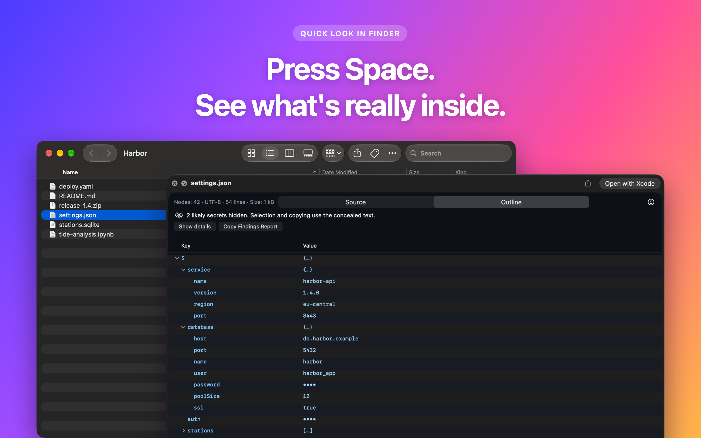
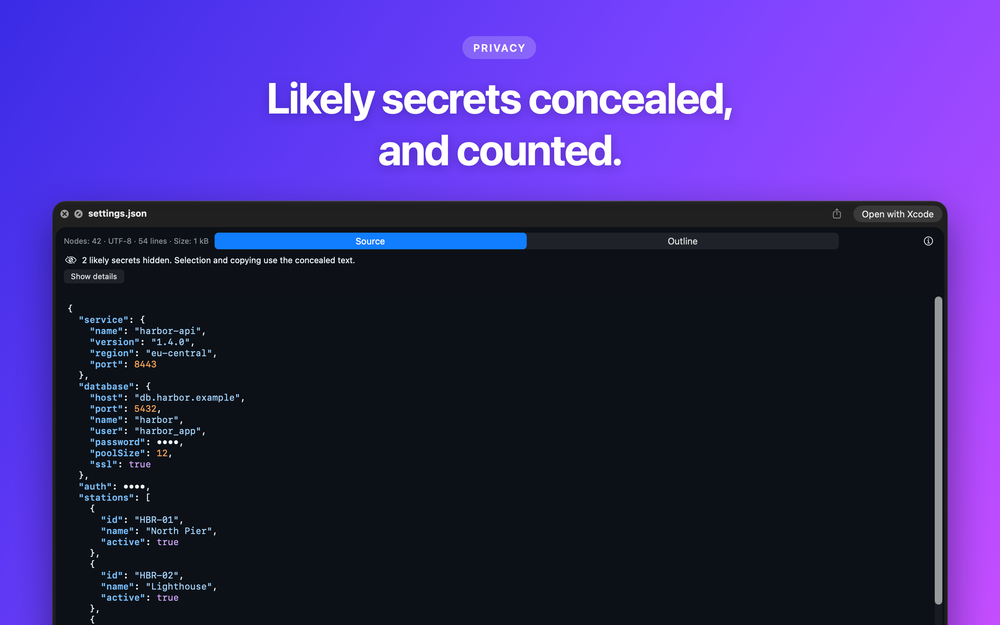
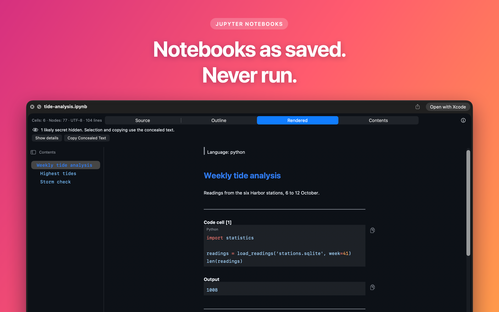
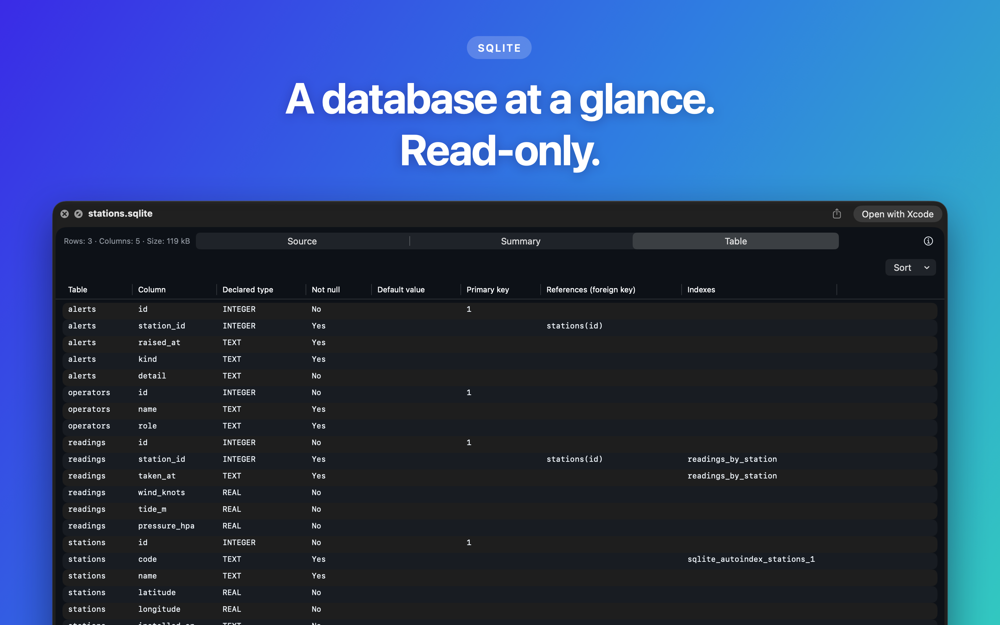
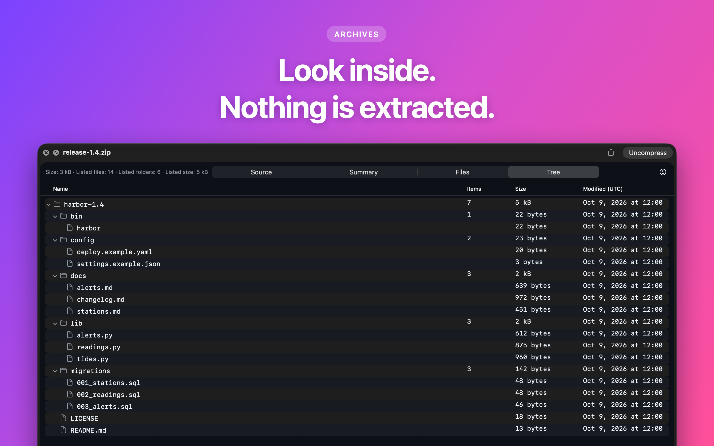
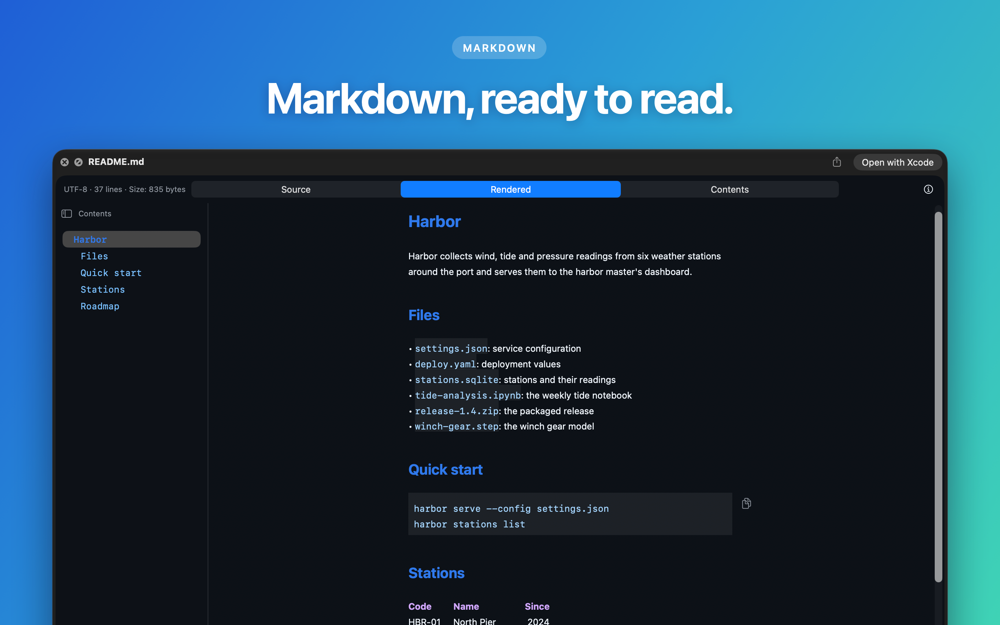
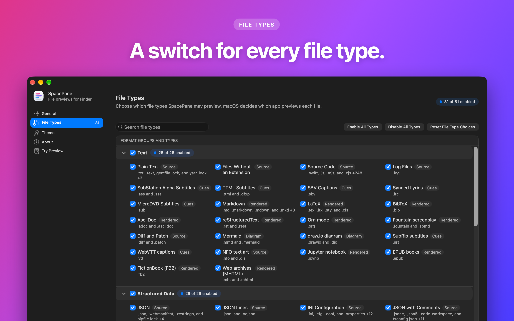
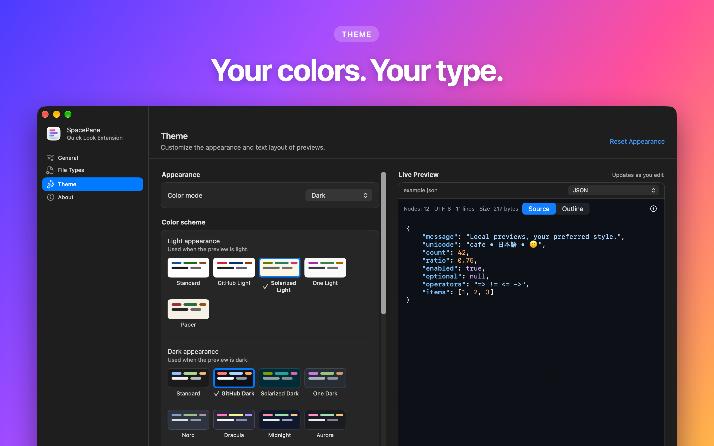

<h1 align="center">SpacePane</h1>

<p align="center"><b>Press Space. See what's really inside.</b><br>
Quick Look previews for the files your Mac can't show yet.<br>
Everything stays on your Mac: files are only read, and nothing inside them is run.</p>

<p align="center"><a href="https://spacepane.com">spacepane.com</a> · macOS 15 or later</p>



## Secrets stay hidden

Likely passwords, tokens and keys are concealed, even in the source view, and kept out of thumbnails. The preview tells you how many it hid.



## Notebooks, shown but never run

Jupyter notebooks render with their cells and saved output. No code is executed.



## Databases at a glance

Open a SQLite file read-only and browse its tables and schema.



## Archives without extracting

ZIP, TAR, 7z, RAR, app bundles, installers and disk images list their contents with sizes and dates. Nothing is unpacked.



## Markdown and code, natively

Markdown renders with a table of contents. Source code, logs, JSON, YAML, TOML, XML, CSV, Parquet, certificates, MIDI, 3D meshes and more get their own views.



## Every file type, your choice

The companion app has a switch for each file type.



## Your colors and fonts

The Theme page changes colors, fonts and spacing, with a live sample of every type.



> macOS decides which installed app previews each file type; SpacePane cannot override it.

## Build locally

Requires full Xcode (Swift 6.2 or later), Python 3 and an Apple Developer team for signing.

```sh
cp Configuration/Local.xcconfig.example Configuration/Local.xcconfig
# Fill in DEVELOPMENT_TEAM, PREVIEW_BASE_BUNDLE_IDENTIFIER and APP_GROUP_IDENTIFIER
./script/build_and_run.sh
```

The script builds, signs and launches the companion app. If `xcode-select` points at the Command Line Tools, first run `export DEVELOPER_DIR=/Applications/Xcode.app/Contents/Developer`. Run the tests with `./script/build_and_run.sh --test`.
