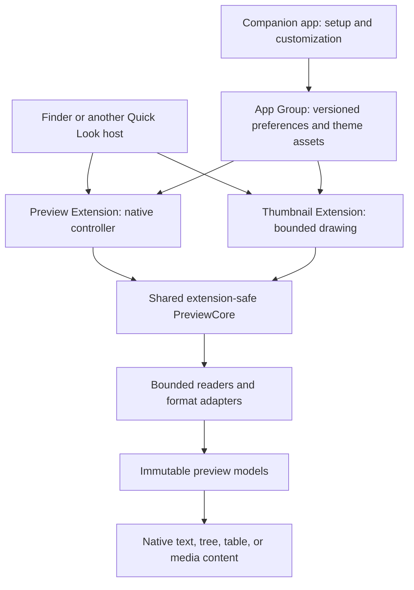

# Task 1 — macOS APIs for Prev

Research date: 2026-10-03. Target: macOS 15 and later. Status: research complete; the runtime experiments below remain unperformed. This repository has no application targets, and the selected developer directory is Command Line Tools rather than a full Xcode installation.

## Decision

Build a sandboxed companion app containing one interactive Quick Look Preview Extension and one Thumbnail Extension. Share an extension-safe parsing and rendering core, plus versioned appearance preferences through an App Group. Keep the companion app independent of the extension processes: Finder previews must work when the companion has quit.

The modern extension APIs provide the needed native preview surface. Apple introduced file preview extensions on macOS in 2019, and the macOS 15 release notes say support for legacy Quick Look generator plugins is being removed. Existing `.qlgenerator` projects are format references, not the distribution architecture. [Apple WWDC19: File Management and Quick Look](https://developer.apple.com/videos/play/wwdc2019/719/), [macOS 15 release notes](https://developer.apple.com/documentation/macos-release-notes/macos-15-release-notes)

“Missing-file previews” has two distinct meanings. Prev can add readers for existing formats that lack a useful preview. It can also explain unavailable contents when invoked. No preview API recreates deleted data or guarantees that Finder invokes Prev for a cloud placeholder, unfamiliar extension, or extensionless file.

## Required and useful API matrix

The classification below is a product recommendation. Linked API behavior is documented; performance and host compatibility require the prototypes later in this report.

| API or framework | Classification | Application and boundaries |
| --- | --- | --- |
| `QuickLookUI`, `NSViewController`, `QLPreviewingController` | Required | Implement `preparePreviewOfFile(at:completionHandler:)` in the preview target. The method receives the requested URL on the main thread; expensive work belongs off that thread. Complete when usable content or the app's fallback state is ready. [Quick Look UI](https://developer.apple.com/documentation/quicklookui), [preparePreviewOfFile](https://developer.apple.com/documentation/quicklookui/qlpreviewingcontroller/preparepreviewoffile(at:completionhandler:)) |
| `QuickLookThumbnailing`, `QLThumbnailProvider`, `QLFileThumbnailRequest`, `QLThumbnailReply` | Required | Implement the thumbnail target separately. Respect request size and scale; return a drawing or image through a reply. Set exact supported identifiers and an appropriate `QLThumbnailMinimumDimension`. [Providing thumbnails](https://developer.apple.com/documentation/quicklookthumbnailing/providing-thumbnails-of-your-custom-file-types), [thumbnail request](https://developer.apple.com/documentation/quicklookthumbnailing/qlfilethumbnailrequest) |
| `UniformTypeIdentifiers`, `UTType`, bundle type declarations | Required | Maintain a tested, explicit routing manifest. Use existing identifiers and imported declarations for externally owned formats. Export only formats Prev owns. A `UTType` value is a type representation, not a runtime registration of a new Quick Look handler. [UTType](https://developer.apple.com/documentation/uniformtypeidentifiers/uttype-swift.struct), [defining types](https://developer.apple.com/documentation/uniformtypeidentifiers/defining-file-and-data-types-for-your-app) |
| App Sandbox and App Groups entitlements | Required from the first prototype | Enable sandboxing for later Mac App Store distribution. Use the same correctly provisioned App Group for the app and both extensions. Shared membership permits access to that container; it does not grant broad access to arbitrary user files. [App Sandbox](https://developer.apple.com/documentation/security/app-sandbox), [configuring App Groups](https://developer.apple.com/documentation/xcode/configuring-app-groups), [macOS 15 App Group authorization](https://developer.apple.com/documentation/xcode/accessing-app-group-containers) |
| `UserDefaults(suiteName:)`, `FileManager.containerURL(forSecurityApplicationGroupIdentifier:)` | Required for customization | Store small settings in group defaults and validated theme assets in the group container. Read a coherent settings snapshot at the start of each request. Cross-process live refresh needs separate validation. [App Group access APIs](https://developer.apple.com/documentation/xcode/configuring-app-groups) |
| Foundation `URL`, `URLResourceValues`, `FileManager`, `FileHandle` | Required | Inspect metadata, perform bounded reads, handle encoding errors, and enumerate permitted folders. `FileHandle.read(upToCount:)` is synchronous; use it on a worker and enforce read limits. [bounded file reads](https://developer.apple.com/documentation/foundation/filehandle/read(uptocount:)) |
| AppKit `NSTextView`, TextKit 2, `NSAttributedString` | Recommended for text-heavy previews | Provide selectable, read-only text, attributed syntax tokens, copy, find, and typography. TextKit 2 manages text layout through `NSTextLayoutManager`; accessing legacy `layoutManager` can switch an `NSTextView` to compatibility mode. Verify the selected engine rather than assuming it. [NSTextView](https://developer.apple.com/documentation/appkit/nstextview), [NSTextLayoutManager](https://developer.apple.com/documentation/appkit/nstextlayoutmanager) |
| `NSFontDescriptor`, `NSFontManager`, Core Text font descriptors | Required for requested typography | Enumerate available font families, match faces, and express weight, size, variation axes, and supported font features. Font features vary by face; absent fonts need a native fallback. [NSFontDescriptor](https://developer.apple.com/documentation/appkit/nsfontdescriptor), [NSFontManager](https://developer.apple.com/documentation/appkit/nsfontmanager), [CTFontDescriptor](https://developer.apple.com/documentation/coretext/ctfontdescriptor) |
| SwiftUI, `NSHostingController`, `NSViewRepresentable` | Recommended | Use SwiftUI for setup, settings, and modest structured controls. Embed it within the extension's AppKit controller; wrap native text or table views where they provide better selection and large-content behavior. [AppKit integration](https://developer.apple.com/documentation/swiftui/appkit-integration), [NSHostingController](https://developer.apple.com/documentation/swiftui/nshostingcontroller) |
| `QLPreviewProvider`, `QLFilePreviewRequest`, `QLPreviewReply` | Useful alternative | Produce data-based image, PDF, or HTML previews. Apple documents `QLIsDataBasedPreview` and the principal-class change. Prefer the view-based extension for interactive JSON trees, database tables, and MIDI controls. Data-based preview classes are documented for macOS 12+, so they fit the macOS 15 target. [QLPreviewProvider](https://developer.apple.com/documentation/quicklookui/qlpreviewprovider), [QLPreviewReply](https://developer.apple.com/documentation/quicklookui/qlpreviewreply) |
| `NSFileCoordinator` and read intents | Useful for coordinated files | Coordinate access to cloud or cooperatively managed documents; keep access short. `withoutChanges` avoids asking presenters to save before reading. This mechanism does not establish a transaction-consistent SQLite snapshot from arbitrary database writers. [read options](https://developer.apple.com/documentation/foundation/nsfilecoordinator/readingoptions), [withoutChanges](https://developer.apple.com/documentation/foundation/nsfilecoordinator/readingoptions/withoutchanges) |
| `AVAudioSequencer`, `AVAudioEngine`, `AVAudioUnitSampler`; AudioToolbox where needed | Required for MIDI baseline | Load MIDI events, play or stop, and seek with sequencer position. A sampler can load DLS/SF2 instruments. Using the installed macOS sound bank from a sandboxed extension and matching General MIDI channel/program behavior are prototype gates. [AVAudioSequencer](https://developer.apple.com/documentation/avfaudio/avaudiosequencer), [AVAudioUnitSampler](https://developer.apple.com/documentation/avfaudio/avaudiounitsampler) |
| SQLite C API through a narrow Swift adapter | Required for SQLite baseline | Use prepared, app-generated read queries, bounded result pages, a progress callback, and cancellation. This is a database library, not a Quick Look framework. Opening and WAL access require the no-source-write design below. [opening SQLite connections](https://sqlite.org/c3ref/open.html), [SQLite security guidance](https://sqlite.org/security.html) |
| Compression, AppleArchive, audited archive libraries | Useful, with distinct jobs | Compression offers buffer and stream codecs. AppleArchive offers its own rich archive streams; it is not evidence of general ZIP/TAR/XIP support. Format containers need a validated parser/library. [Compression](https://developer.apple.com/documentation/compression), [AppleArchive](https://developer.apple.com/documentation/applearchive) |
| ImageIO, Core Graphics, Security certificate APIs | Useful expansion APIs | Read image metadata/downsample images; draw swatches, maps, or simple static diagrams; inspect X.509 fields locally without importing certificates into Keychain. [CGImageSource](https://developer.apple.com/documentation/imageio/cgimagesource), [SecCertificateCopyValues](https://developer.apple.com/documentation/security/seccertificatecopyvalues(_:_:_:)) |
| `QLPreviewPanel`, `QLPreviewView`, `QLThumbnailGenerator` | Useful for companion diagnostics | Present system previews or request system thumbnails in the companion app. These consumer APIs do not implement Finder's provider or guarantee the selected provider is Prev. [Quick Look UI](https://developer.apple.com/documentation/quicklookui), [Quick Look Thumbnailing](https://developer.apple.com/documentation/quicklookthumbnailing) |
| Unified logging and Instruments | Useful for verification | Measure load, parse, and render stages with local signposts and inspect CPU, allocations, and hangs. Log classifications and durations rather than file contents or sensitive paths. [Logger](https://developer.apple.com/documentation/os/logger) |

All chosen APIs must compile for the macOS 15 deployment target with extension-safe API checking enabled. Current documentation includes newer or beta symbols alongside existing APIs; their presence in a reference page does not establish macOS 15 availability. Check each adopted symbol's availability and the selected SDK. There is no existing `.pbxproj` or `Package.swift` from which to infer Swift language mode or concurrency defaults.

## Finder routing is a separate contract from parsing

Apple's macOS preview presentation states that `QLSupportedContentTypes` must match file UTIs exactly; matching a parent type is unsupported. The current thumbnail article states the same rule. Consequently, declaring `public.text`, `public.data`, or `public.archive` is not a universal fallback for conforming subtypes. Maintain exact identifiers in both extension manifests. [Apple WWDC19](https://developer.apple.com/videos/play/wwdc2019/719/), [thumbnail type matching](https://developer.apple.com/documentation/quicklookthumbnailing/providing-thumbnails-of-your-custom-file-types)

Imported type declarations describe externally owned formats using their canonical identifiers and associated tags. Apple says not to redeclare system-provided types or invent a replacement identifier when importing another app's type. Standard type mappings and third-party installations can affect the identifier a real file receives. [Defining file and data types](https://developer.apple.com/documentation/uniformtypeidentifiers/defining-file-and-data-types-for-your-app)

No documented API reviewed here guarantees that Prev wins when multiple providers support an identifier. `LSHandlerRank` ranks apps as file editors/viewers; it is not a documented Quick Look priority control. Returning an error also must not be treated as a promise that Finder will try another provider. [LSHandlerRank](https://developer.apple.com/documentation/bundleresources/information-property-list/cfbundledocumenttypes/lshandlerrank)

A settings toggle can change how Prev renders requests it receives. It cannot safely rewrite the signed bundle's type declarations. Adding guaranteed static routing declarations requires an app update; user-entered extension aliases can only guide detection after invocation or when the companion explicitly opens a file. Extensionless names, dotfiles such as `.env`, `package.json` specializations, folders, Apple's built-in CSV previews, and provider conflicts each need real Finder tests.

The extension owns its embedded content. The Quick Look host owns the surrounding panel, standard title area, sizing, navigation, and dismissal. Apple notes previews can appear in a panel, Finder column view, Spotlight, or another `QLPreviewView` client. Put metadata and controls inside the content, and support compact hosts rather than assuming a large standalone window. [Apple WWDC19](https://developer.apple.com/videos/play/wwdc2019/719/)

## Integration architecture and settings lifecycle

Recommended boundaries:

- `PreviewCore`: file classification, bounded readers, typed errors, redaction, format models, and budget accounting. Keep host UI and companion-only APIs out.
- `PreviewRendering`: native text, structured tables/trees, common empty states, and theme application.
- `PreviewExtension`: host callback, request ownership, main-actor UI, short-lived resources, and cleanup.
- `ThumbnailExtension`: stricter budgets and a safe thumbnail policy; no playback or secret-revealing text.
- `CompanionApp`: onboarding, preferences, local fixtures, explicit file opening, and diagnostics.

An app extension has a lifecycle controlled by its host and can run while its containing app is absent. Shared frameworks must use only APIs available to extensions; enable the build setting that requires extension-safe APIs. [App extension lifecycle](https://developer.apple.com/library/archive/documentation/General/Conceptual/ExtensibilityPG/ExtensionOverview.html), [sharing extension-safe code](https://developer.apple.com/library/archive/documentation/General/Conceptual/ExtensibilityPG/ExtensionScenarios.html)

The accepted synthesis uses one atomically published versioned preferences document and validated theme data in the App Group. Group defaults may hold independent simple flags; do not duplicate the same preference across two sources of truth. A Swift actor serializes state within one process, not across separate extension and companion processes. Publish theme files atomically and coordinate any multi-process writes. Treat malformed or newer schemas as a reason to use safe defaults. Read fresh preferences on each request so customization works with the companion closed.

The documented enablement route is System Settings → General → Login Items & Extensions → Quick Look. User-facing help should provide this path. A direct URL into a particular System Settings pane is an optional convenience requiring OS testing, not the onboarding's only route. [Apple Support: extension settings](https://support.apple.com/guide/mac-help/mtusr003/mac)

`NSExtensionContext.open` exists, but its documentation explicitly leaves support to each extension point. Do not require a Quick Look preview to launch the companion or Settings successfully. Keep a discoverable companion menu and help path; validate any extension launch action before relying on it. [NSExtensionContext.open](https://developer.apple.com/documentation/foundation/nsextensioncontext/open(_:completionhandler:))

## File access, read-only behavior, and unavailable contents

### Access must match the actual request

Use the URL supplied by the host for the preview operation and handle failed reads as normal outcomes. Do not assume the extension inherits the companion's user-selected grants or obtains the source's entire parent directory. Test related resources individually: SQLite WAL files, Markdown images, symlink targets, and files inside packages are important cases.

For the companion's Open/drop workflow, prefer read-only user-selected access through `NSOpenPanel` or SwiftUI `fileImporter`. If persistent access is a real feature, store read-only security-scoped bookmarks, handle stale bookmarks, and balance access lifetime. A plain path string cannot transfer sandbox permission between processes; Apple's bookmark mechanism can transfer scoped access. POSIX permissions and other macOS protections still apply. [Accessing files from the macOS App Sandbox](https://developer.apple.com/documentation/security/accessing-files-from-the-macos-app-sandbox)

Folder previews must have a bounded enumeration depth/count, avoid following links automatically, and tolerate inaccessible descendants. An extension's received URL is not authorization to scan unrelated folders. Request-time access should not create a permanent file history or content cache.

### SQLite: read-only does not by itself prove no source side effects

`sqlite3_open_v2` with `SQLITE_OPEN_READONLY` refuses to create a missing database. `mode=ro` is equivalent read-only connection access. Avoid the default `sqlite3_open` behavior, which can create a missing file. [SQLite open flags](https://sqlite.org/c3ref/open.html)

WAL-mode access is subtler: official documentation describes needing existing readable `-wal`/`-shm` files, the ability to create them, or an immutable connection. The WAL index is shared memory backed by `-shm`. Therefore read-only SQL is not enough evidence for the claim “without changing the database or related source files.” [SQLite WAL read-only conditions](https://sqlite.org/wal.html), [WAL file format](https://sqlite.org/walformat.html)

`immutable=1` disables locking and change detection and asserts that the underlying file cannot change. Applying it to a live mutable source can produce wrong results or corruption errors. Use it only for a genuinely immutable source or a stable private snapshot. [SQLite URI semantics](https://sqlite.org/uri.html)

The initial SQLite implementation must prove a no-source-write strategy before shipping. A bounded private snapshot or carefully audited read-only VFS is a candidate, not an accepted implementation. Simply copying a live main database and its WAL separately is not proof of consistency; `NSFileCoordinator` is not a substitute for SQLite transaction synchronization. SQLite's online backup API can create a consistent snapshot, but source connection setup still needs a proven no-side-effect path, and sustained writes can prevent completion. [SQLite backup API](https://sqlite.org/backup.html)

For a safe database connection, use generated/parameterized queries, strict identifier quoting, no arbitrary SQL console, no extension loading, a restricted authorizer, defensive configuration where available, limits on cells/blobs, short busy timeouts, and a progress callback. Restrict initial table sampling and avoid expensive automatic row counts. Verify runtime SQLite capabilities rather than assuming every current upstream option exists in macOS's library. [SQLite security guidance](https://sqlite.org/security.html)

If consistent WAL access is unavailable within the sandbox, show a precise partial/unavailable state. Do not silently claim that a view of the main file includes recent WAL commits, and never change source journal mode to make previewing easier.

### Unsupported and genuinely unavailable files

| Situation | Honest supported behavior | Limit |
| --- | --- | --- |
| Existing file, no specialized decoder | Bounded text detection, encoding choice where safe, metadata, or an opt-in bounded hex view | Works in Finder only if Prev is invoked. The companion's explicit Open/drop route can offer this independently. |
| iCloud file not materialized locally | Metadata/status and an explanation that contents are unavailable | Finder or coordination may request materialization before the extension receives the request. No guarantee of a placeholder preview. |
| Third-party File Provider placeholder | Handle coordinated reads, timeouts, and provider failures; show metadata if supplied | iCloud-specific download APIs are not a general downloader for every provider. |
| Moved/deleted during preparation | Close resources and show “File is no longer available”; permit retry when there is a valid URL | No recovery of unavailable bytes; do not search the disk for a replacement. |
| Permission denied or disconnected volume | State that contents cannot be read; show only accessible metadata | Metadata may also be unavailable. Do not attempt to bypass privacy or sandbox restrictions. |
| Broken alias/symlink | Show accessible link information and the failure | Do not automatically broaden access to an arbitrary target. |
| Corrupt, encrypted, or budget-exceeding content | Explain the specific limitation, retain safe metadata, and offer bounded source fallback when useful | A partial preview must clearly identify its omissions. |

`NSFileCoordinator.ReadingOptions.immediatelyAvailableMetadataOnly` explicitly permits metadata access without triggering a download; reading file contents under that option may fail or behave unexpectedly. Use it for a metadata-only path, not as a content-read bypass. [metadata-only coordination](https://developer.apple.com/documentation/foundation/nsfilecoordinator/readingoptions/immediatelyavailablemetadataonly)

`FileManager.startDownloadingUbiquitousItem` requests iCloud download/synchronization, and URL resource values expose iCloud status. Prev should not start downloads automatically as part of its local-only preview pipeline. A future explicit download action, if justified, belongs in a tested companion workflow and must explain that macOS/cloud storage performs the transfer. [iCloud download API](https://developer.apple.com/documentation/foundation/filemanager/startdownloadingubiquitousitem(at:)), [iCloud URL values](https://developer.apple.com/documentation/foundation/urlresourcevalues/ubiquitousitemdownloadrequested)

## Format-specific API cautions

- **GZIP and archives:** Apple's `COMPRESSION_ZLIB` uses raw DEFLATE. It does not alone parse a `.gz` wrapper, ZIP central directory, TAR headers, or XIP container. zlib's GZIP-aware stream APIs can process GZIP framing. Use format-aware readers and bounds on compressed input, decoded output, entry count, nesting, and processing time; never extract source archives into the filesystem to generate a listing. [COMPRESSION_ZLIB](https://developer.apple.com/documentation/compression/compression_zlib), [zlib manual](https://zlib.net/manual.html)
- **XIP:** Listing the outer XAR table of contents is not a listing of the files inside Xcode. The primary `unxip` implementation documents outer `Metadata` and `Content` entries, with `Content` holding chunked PBZX data that expands to a CPIO stream. A real file list needs a bounded XAR → PBZX/decompression → CPIO pipeline; reaching later entries may require substantial sequential decoding. XAR support in an archive library alone does not satisfy this feature. Validate the composite reader with real fixtures and label listings unverified: container inspection and cryptographic signature verification are separate. `unxip` is an implementation reference, not a selected dependency; its LGPL license needs a separate reuse review. [unxip's format and stream documentation](https://github.com/saagarjha/unxip#design)
- **Markdown:** Foundation's Markdown-to-`AttributedString` initializer is useful for attributed text. It is not an entire Markdown document viewer with layout, navigation, code highlighting, and diagram rendering. Those remain renderer responsibilities. [AttributedString Markdown parsing](https://developer.apple.com/documentation/foundation/attributedstring/init(markdown:options:baseurl:)-52n3u)
- **Web content:** If a later rich format needs `WKWebView`, disabling content JavaScript is useful but does not itself block images, CSS imports, fonts, or network fetches. Sanitize content, prohibit external resources, restrict navigation and file read access, and apply content rules before loading. Do not execute code from notebooks, Markdown, Vega files, or Lottie documents as an unrestricted page. [allowsContentJavaScript](https://developer.apple.com/documentation/webkit/wkwebpagepreferences/allowscontentjavascript), [WKContentRuleListStore](https://developer.apple.com/documentation/webkit/wkcontentruleliststore)
- **MIDI:** Parse before starting playback; no autoplay. Test Standard MIDI File formats 0 and 1, tempo changes, seeking, instrument changes, empty or malformed tracks, and every host teardown path. Stop sequencer/engine activity on disposal and ensure timers do not retain the preview. The public sequencer supports loading, seeking, and stopping; correct sound-bank behavior within Quick Look remains an integration gate. [AVAudioSequencer](https://developer.apple.com/documentation/avfaudio/avaudiosequencer)
- **Thumbnails:** A thumbnail can be retained by system caches and, for iCloud custom files, generated alongside the synced file. Secret reveal must never affect thumbnails. Prefer a generic/type summary for environment files and potentially sensitive source content rather than snippets. Prev controls its submitted representation, not every host's persistence or invalidation. [thumbnail extension behavior](https://developer.apple.com/documentation/quicklookthumbnailing/providing-thumbnails-of-your-custom-file-types)

## Failure, concurrency, and cancellation contract

The preview callback starts on the main thread, and Apple asks developers to avoid expensive work there or holding file descriptors open throughout the preview. Read the minimum needed content off-main, produce immutable preview data, close the reader, then update native UI on the main actor. Reopen briefly for bounded interactions rather than holding source handles indefinitely. [preparePreviewOfFile](https://developer.apple.com/documentation/quicklookui/qlpreviewingcontroller/preparepreviewoffile(at:completionhandler:))

Recommended request state: `created → loading → ready | partial | unavailable | failed | cancelled → disposed`. Each request owns its worker, budget, completion gate, decoder resources, and media teardown. Completion must not fire twice; stale work must not update a replacement view. Changing theme should reuse safe parsed data when practical rather than rereading the source.

The reviewed modern request APIs do not expose the legacy generator cancellation flags. Do not transplant `CancelPreviewGeneration` or `QLPreviewRequestIsCancelled` from a `.qlgenerator` into an app extension. `QLThumbnailGenerator.cancel` cancels a **consumer** thumbnail request; it is not a cancellation method provided to `QLThumbnailProvider`. [QLPreviewingController](https://developer.apple.com/documentation/quicklookui/qlpreviewingcontroller), [QLFileThumbnailRequest](https://developer.apple.com/documentation/quicklookthumbnailing/qlfilethumbnailrequest), [consumer cancellation](https://developer.apple.com/documentation/quicklookthumbnailing/qlthumbnailgenerator/cancel(_:))

Use cooperative cancellation checkpoints in parsing/decompression loops, bounded worker concurrency, and deadlines independent of host teardown. Cancel owned tasks and media on the applicable view/controller lifecycle, while treating the precise lifecycle callback sequence as a host test. Swift task cancellation does not interrupt arbitrary synchronous I/O automatically. `NSFileCoordinator.cancel()` can stop waiting for coordination, but an executing accessor block continues until it finishes. [file coordination cancellation](https://developer.apple.com/documentation/foundation/nsfilecoordinator/cancel())

For SQL cancellation, `sqlite3_interrupt` can be called from another thread, but only while the connection remains valid. Define connection ownership so cleanup cannot close it before the interrupt call returns; pair it with the progress handler and row budget. [SQLite interrupt](https://sqlite.org/c3ref/interrupt.html)

Budget fields should cover input bytes, decoded bytes, nodes, depth, archive entries, database cells, image pixels, CPU/wall time, and number of simultaneous decoders. Exact values are product test targets, not Apple-published Quick Look process quotas. A timeout alone is not a hard kill for a blocking library: reject unsuitable libraries or isolate them through an extension-safe, measured architecture if necessary.

## APIs and integration patterns to avoid

| Approach | Reason |
| --- | --- |
| Legacy CF plug-in Quick Look generators and generator cancellation callbacks | Removed/deprecated path on the target OS; use modern extensions. |
| `QLPreviewController` as the macOS Finder provider | It is a preview consumer in the iOS/Catalyst API; the native macOS provider uses QuickLookUI extension APIs. |
| Claiming global fallback through `public.data`, changing default editors, or exporting other vendors' UTIs | Exact routing and canonical type declarations do not provide that contract. |
| Editing signed `Info.plist` files at runtime | It is not a supported dynamic type-registration strategy. |
| `NSApplication.shared`, arbitrary extension-unavailable APIs, and shared modules containing companion-only UI | Extension-safe API checks and App Store compatibility apply to shared code. [extension-safe shared frameworks](https://developer.apple.com/library/archive/documentation/General/Conceptual/ExtensibilityPG/ExtensionScenarios.html) |
| Shelling out to user-installed Node, Python, R, command-line highlighters, or archive tools | Adds launch cost and undeclared dependencies, and can execute untrusted behavior. Prefer linked, audited readers. |
| Full Disk Access, Accessibility automation, Finder injection, or a login helper as baseline requirements | These are not necessary Quick Look integration APIs and do not solve type-routing guarantees. |
| Building a File Provider or Finder Sync extension to intercept all files | These extension points serve other purposes and do not replace a Quick Look preview provider. |
| Automatically loading remote images, evaluating notebook cells, running package scripts, or importing certificate/private-key material | Previewing is inspection, with no source execution or external effects. |
| Unbounded `Data(contentsOf:)`, eager recursive trees, automatic decompression, and main-thread database queries | Large or malicious files need bounds before allocation and work. |

## Required prototype tests before implementation claims

These are unchecked because research does not establish runtime behavior.

- [ ] Create signed sandboxed app + preview + thumbnail targets; verify extension-safe API checking, embedding, bundle identifiers, deployment target, and App Group authorization with full Xcode.
- [ ] On macOS 15 and the newest supported stable release, test registration, user enablement, host app quit, relaunch, app upgrade, and a clean install; verify the documented Settings path.
- [ ] Record actual file UTIs and provider invocation for JSON, JSONL, YAML, TOML, Markdown, source code, SQLite, archives, MIDI, `.env`, extensionless names, ordinary folders, and CSV. Repeat with a competing provider installed; keep thumbnails and previews as separate results.
- [ ] Exercise Finder Space, column/preview pane, Spotlight, and a companion `QLPreviewView` with compact and large sizes. Verify text selection, copy/find, keyboard dismissal, focus, and accessibility without taking over host shortcuts.
- [ ] Test App Group preferences with the app quit, extension process reuse, concurrent writes, malformed theme files, appearance changes, missing fonts, and schema migrations. Measure whether open previews refresh; do not promise live updates before this passes.
- [ ] Test host-provided grants and sibling access: Markdown images, SQLite sidecars, packages, symlinks, folders, protected descendants, stale companion bookmarks, and disconnected volumes.
- [ ] Test actual iCloud and third-party placeholders online/offline, failures before invocation, metadata-only coordination, slow SMB reads, and file moves/deletion during preparation. Verify no automatic Prev download request.
- [ ] Prove SQLite source nonmutation for rollback-journal, quiescent WAL, active WAL, absent/unreadable sidecars, malformed schema, huge cells, and concurrent writers. Check source files, sidecars, directory contents, observed writes, and displayed consistency. Fall back when the guarantee cannot be met.
- [ ] Test ZIP64, malformed ZIP offsets, GZIP framing/members, TAR variant handling, XIP container variants, encrypted/split archives, nested archives, and decompression bombs. Verify no extraction and budgets at every stage.
- [ ] Verify MIDI sound-bank loading, audio output, scrub behavior, no autoplay, cancellation, host close, rapid file switching, and extension termination; ensure all notes and timers stop.
- [ ] Confirm invalid files and rapid navigation complete or dispose cleanly without stale output. Measure cold/warm first-content latency, scrolling, allocations, and peak memory for each renderer on representative hardware.
- [ ] Validate thumbnail secrecy and behavior under Finder/iCloud caching; verify theme changes do not require undocumented global cache deletion.
- [ ] Before App Store submission, recheck sandbox entitlements, bundled library licenses, extension-safe dependencies, current privacy manifest applicability, and current review requirements. Apple's required-reason API article currently enumerates mobile platforms rather than macOS; do not assume a universal macOS rule from its title. [Required-reason API scope](https://developer.apple.com/documentation/bundleresources/describing-use-of-required-reason-api)

## Accepted API conclusions and remaining decisions

Accepted: modern app extensions; native controller for interactive content; separate safe thumbnails; exact static type manifests; App Group settings; sandbox-first prototypes; bounded local readers; companion Open/drop fallback; no promise of data recovery or provider priority.

Still subject to evidence: directory and extensionless Finder routing, launch links from preview controls, live preferences/cache invalidation, sibling resource access, consistent SQLite snapshots with zero source side effects, XIP listing, and MIDI sound-bank behavior. These are prototype gates that can narrow shipped support without invalidating the overall architecture.
